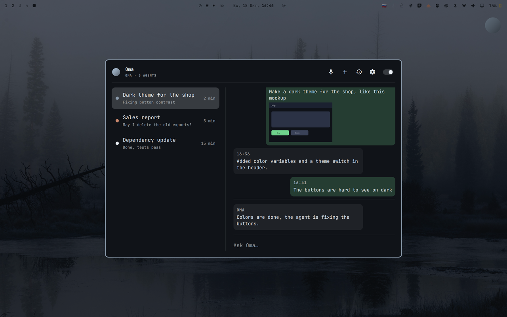

# agent-speak

Озвучка ИИ-агентов (Claude Code, Codex) и голосовой заместитель **Ома**. Ома следит за агентами, которых запустил пользователь, коротко докладывает их состояние голосом и текстом, отвечает на вопросы, передаёт агентам ваши ответы и задания, запускает новых, а повисших и упавших агентов поднимает сама. Голос — Silero `v5_6_ru`, по-русски: предложение на «?» модель сама читает вопросом, на «!» — восклицанием. Текст готовится к чтению без ИИ на пути к звуку: код и markdown выбрасываются, пути (и относительные, `src/x.rs:120`) — имя файла, числа — словами (с ведущими нулями «0.05», разрядами «1 000» и временем «12:30»; список трёхзначных через пробел «100 200 300» пока читается одним числом; запятая — разряды только в «1,000» и «1,234,567», иначе десятичная, как «1,155»; падежи не склоняются), знаки, которых нет у Silero, — словами («×» — «на», «=» — «равно», «!=» — «не равно», «>=» и «<=» — «не меньше» и «не больше», «=>» — «в», «+» — «плюс»; «/» — граница слова, пробел, а не пауза; зачёркивание `~~` и подчёркивание заголовка `=====` — разметка, не читаются; «слово/имя.ext» с заглавной или файлом слева от «/» — перечисление «TypeScript/Node.js», а не путь), сокращения с точкой («т. е.», «т. к.», «см.», «напр.», «тыс.», «и т. д.») — полностью и не рвут предложение, английские термины — по словарю.



## Ома

- **Орб** — кружок поверх всех окон, и полноэкранных тоже (настройка «Над полноэкранными окнами» выключена — под ними). Клик — разговор с Омой, ПКМ — окно, СКМ — сводка агентов одной фразой. Перетаскивается куда угодно; отпущенный у угла (ближе ~64 px) защёлкивается в угол, у края вне угла остаётся где отпущен; место запоминается.
- **Агенты на орбе** (пока «Следить за агентами» включено):
  - **Карточка при наведении** (0,4 с) вместо подсказки в одну строку: сверху состояние Омы, ниже агенты, срочные первыми — ждут ответа (дольше всех ждущий сверху), со словом сторожа, работают, готовы, свободны (в последних трёх группах свежие сверху; порядок — `Model.peekRows`, у окна свой, устойчивый). У агента точка цвета состояния, название, давность — с последнего события агента (на миг показа, пока карточка открыта, не тикает) и строка до 60 знаков: у ждущего — первая строка вопроса, у слова сторожа — само слово, у остальных — что делает. Не больше 8 строк, дальше «ещё N». Только для чтения: звука и токенов нет. Агентов нет — прежняя подсказка.
  - **Спутники** — по точке на агента на дуге у орба, в пределах его ширины (пузыри стоят сбоку, край экрана дугу не режет): у верхних углов — под орбом, у нижних — над ним. Место точки закреплено за агентом, пока он жив (`Model.satSlots`): новый берёт первое свободное, ушедший освобождает своё. Цвет — состояние, как в окне: работает — акцент, ждёт — красный, слово сторожа — оранжевый, готов — цвет текста, свободен — серый; своего цвета у агента нет. Агент стал ждать ответа — его точка трижды вспыхивает (около 2,4 с) и стоит красной. Наведение — подсказка «Astral.Edo — ждёт · 15 мин», клик — чат агента в окне. Удержание точки (0,45 с) — разговор с этим агентом, не называя его: Ома слушает в его чате, точка обведена зелёным, пока она там слушает (так же — в окне ответа после его новости); голосом поручение и здесь уходит только после «да, передай». Удержание, пока открыто окно ответа (после новости, «Ты тут?», вопроса агента), делает его обычным разговором: реплика уходит без контекста той новости, после ответа Ома слушает дальше, конец — после 30 с тишины. На окно уже ответили, и Ома думает или говорит ответ — удержание обрывает его, как клик, снимает окно и слушает в чате агента. Набрали реплику в другой чат посреди разговора — голос идёт туда, и обводка уходит с точки (строка `chat` с `was "*"`). Отпускание после удержания — не клик: так ведёт себя штатный `MouseArea` с обработчиком удержания. Файл, снимок экрана, ссылку или текст можно бросить на точку — откроется чат агента, и это будет в поле у курсора, через пробел от недописанного слова перед ним (локальный файл — путь, с пробелами — в кавычках); на сам орб — общий чат. Отправляет Enter, как набранное. Дойдёт ли перетаскивание до слоя орба (Wayland, layer-shell), пока не проверено вживую: под перетаскиванием точка обводится, орб «просыпается» — не обводится, значит, до орба оно не доходит. Агентов больше пяти — четыре самых срочных и полая точка «ещё» без цифры (число — в её подсказке, клик — окно); места тогда держатся, где могут. Спутников нет, пока открыто окно Омы, и с выключенной настройкой «Спутники агентов» (`orb_satellites`).
  - **Средний клик по орбу** — сводка одной фразой, собранной кодом, без мозга Омы (незнакомое имя проекта один раз уходит в словарь произношения, как любое слово речи): «omarchy-vpn завис, ждёт ответа astral, работают agent-speak и datebook, готов dtc.» — слово сторожа, ждут ответа, работают, готовы; свободных не называет; имена — папки проектов, больше трёх в группе — числом («работают 4 агента»); все свободны — «Все свободны.», агентов нет — «Агентов нет.». Фраза звучит и появляется пузырём Омы (клик по нему — её чат). Это явный жест: звучит и в тихом режиме, как ручное чтение; при показе экрана и «Не беспокоить» — только пузырь (при показе — «ответ в окне»), без звука. Что-то звучит — клик это останавливает, как `agent-speak read`. На тачпаде средний клик — тап тремя пальцами, если он включён.
- **Состояния орба** — цвет и тонкая иконка в центре, из одного в другое орб перетекает плавно: плоский градиент акцента темы — покой; зелёно-жёлтый с микрофоном, плывёт и дышит — слушаю; жёлтый с мозгом, кружится — думаю; синий с динамиком, пульсирует — говорю; как покой, с паузой — пауза (микрофон занят другой программой); красный с «?» — агент ждёт ответа; оранжевый с треугольником «!» — сторожу нужна помощь пользователя (агент висит посреди опасного действия, поднять не вышло, ошибка API); пунктирное кольцо над бледным зелёным — загрузка слуха; серый неподвижный диск с перечёркнутым микрофоном — микрофон выключен, пока Ома слушает (подсказка «Микрофон выключен»); луна — тихий режим; бледное кольцо — Ома не запущена. Иконки — [Lucide](https://lucide.dev) (ISC).
- **Орб живее** (волна «Джарвис», волна 3). Иконки прежние, меняются только движение и цвет.
  - **Слышит:** пока Ома слушает, диск растёт и опадает с уровнем голоса на её входе (стоковый `PwNodePeakMonitor` на узле `ear_in` или на входе по умолчанию; пик в дБ: −50 дБ — 0, −10 дБ — 1, рост сразу, спад ~150 мс — `Model.level`). Тишина — диск стоит, течёт только цвет. Вход без `PwNode.audio` в Quickshell (виртуальный) — прежнее дыхание, уровня нет. Монитор уровня — свой поток захвата `quickshell-peak-monitor`, только в «слушаю»; Ома (`context.foreign_capture`) и присутствие (`micBusy`) по стоковому правилу `isShellLevelMeter` чужим микрофоном его не считают. Тонкая дуга цвета режима от верха по ободу убывает — сколько она ещё слушает (окно после новостей, «Ты тут?», 30 с тишины в разговоре); заговорил — дуга гаснет, после фразы взводится заново.
  - **Микрофон выключен** — выключен вход по умолчанию (клавиша mute глушит только его) или вход Омы (без гарнитуры она пишет `alsa_input.*` в обход него). Ома уважает mute: `Ear.start` спрашивает `pactl get-source-mute` и выбрасывает кадры до VAD с первого, как при чужом микрофоне, — ничего не распознаётся и не хранится; mute и чужую запись, пока слух открыт, ловит подписка `pactl subscribe` (MicWatch: проверка по событию — новый или ушедший поток записи, смена входа, mute; пачка событий — одна проверка; слух закрыт — подписки нет; раньше это был опрос раз в секунду), разговор встаёт на паузу; та же проверка снимает паузу слуха, когда она разошлась с микрофоном (mute сняли раньше проверки — Ома не остаётся глухой). Шапка окна показывает то же — серый диск и «Микрофон выключен»: mute читает орб, окно берёт его у орба (`Oma.qml`, `micMuted`). «Ты тут?» звучит, как раньше: ответом засчитывается движение мыши. Набранное в окне работает. Выключателя нет: это приватность.
  - **Настроение орба** (`orb_moods`, по умолчанию включено; пока «Следить за агентами» включено). Кольцо «готово» — тонкое зелёное (`palette.json` green) по ободу, пока есть готовый агент, которого не видели: вкладка не была в фокусе и чат не открывали в окне (`Model.seenDone`; снова «готов» — снова кольцо). Предел: фокус служба узнаёт по требованию, кольцо может гореть до следующей проверки или до «свободен» через 600 с. «Поник» — у агента 3 и больше вызовов инструментов за ход не отработали (счёт обнуляют промпт, конец хода и уход в покой без хука — Esc; агент не работает и не ждёт ответа — не в счёт): диск мельче (×0,94), цвета на 40 % ближе к `Color.muted`, только в покое, «ждёт ответа» и «нужна помощь»; в карточке у работающего агента вторая строка «ошибок за ход: N». Волна — новость пришла, а Ома её сейчас не говорит (тихий режим, разговор, «занят», тишина по причине, итог ждёт пачки `news_every`; важное промежуточное вслух не звучит никогда — волна у него всегда): одна волна от центра к ободу за 600 мс, итог — зелёная, вопрос — красная, статус — акцент; агент, чей чат открыт или которым пользователь занят, волны не даёт.
  - **Колесо над орбом**, пока Ома говорит (её ответ, новости, чтение): вверх — быстрее, вниз — медленнее, шаг на каждые ±120 `angleDelta` (`Model.wheelStep`; тачпад шлёт мелкие), на краях упирается. Новый темп — со следующей фразы: звучащая и хвост канала идут прежним. Пульс речи на орбе идёт за темпом, в подсказке и карточке — «Темп: быстро». Ответ кончился (всё смолкло и удержания нет) — темп из настроек; config.toml не пишется, «Скорость» в окне сбрасывает темп колеса.
  - **Лимит** — неподвижная жёлтая дуга (`palette.json` yellow) на правом нижнем ободе, пока фраза «лимит почти кончился» в строке состояния; цифр нет. В стоячих режимах; если горят и кольцо «готово», и лимит, жёлтая дуга — поверх.
  - **Живее:** открылся слух — один толчок +8 % за 300 мс; речь — пульс со второй фазой в 1,618 раза быстрее (не метроном), период 480 мс × темп (очень медленно 1,35 … очень быстро 0,75); курсор над орбом — он «просыпается»: ×1,04 и блик за 180 мс. Покой (`orb_idle_motion`, «Дышит в покое», по умолчанию включено): один медленный вдох (1,6 с, ×1,03) раз в 45 с — только от сети (`UPower.onBattery`), не под окном Омы и без «меньше движения». Масштабы перемножаются, итог не больше запаса слота (×1,12). Все новые анимации идут через `Style.duration`: при `reduceMotion` их нет (и волны тоже). Цену вдоха на перерисовке окна орба не мерил.
- **Пузыри** у орба — до трёх, самый старый тает. По тону различаются: вы, Ома, агенты; кто говорит — приглушённым капсом над текстом. Пузыри агентов — пересказы Омы (итог хода, вопрос, важное промежуточное), а не сырой текст агента. Текст пузырей — без разметки markdown (звёздочек, маркеров списка, бэктиков), и у ответов Омы тоже; в чате окна разметка остаётся. Ключи и пароли в пузырях закрыты всегда, и без показа экрана: ключ с известным префиксом (список из правил gitleaks: `ghp_`, `sk-ant-`, `AKIA`, `hf_` и др., тело от 16 знаков с цифрой; у `AKIA` и `ASIA` — ровно 16 знаков `[A-Z2-7]`, цифры может не быть) — «ghp_…», JWT — «eyJ…», значение после `password`, `secret`, `token`, `api_key` и `=` или `:` — «•••», блок `-----BEGIN … PRIVATE KEY-----` (и PGP `… PRIVATE KEY BLOCK`) — до конца текста (`mask_secrets`, `src/text/clean.rs`). Ответ Омы приходит в пузырь кусками, а маска и снятие разметки судят его целиком: блок ключа или значение после `password:` в следующем куске тоже закрыты, пузырь заменяется всем ответом. Хэши коммитов, UUID и пути не трогаются; голос и чат окна не маскируются. Пока вы говорите, виден черновик «…», дальше — распознанный текст; кнопки «Отправить» нет. ЛКМ — окно с чатом пузыря (у агента — его чат, иначе — текущий чат Омы), ПКМ — убрать пузырь (черновик — отменить фразу, как Esc). Вне тихого режима гаснут через 10 секунд, в тихом — висят до ПКМ. Единственный агент в фокусе пузырей не даёт — на него и так смотрят; агентов несколько — пузыри есть.
- **Окно** (`Super+Shift+S`): слева первой строкой «Ома» — общий чат с Омой-помощником (с орбом и постоянной цветной подложкой, чтобы его было видно среди агентов), под ней агенты (работает / ждёт ответа / готово / простаивает; список обновляется на месте — прокрутка не сбрасывается, курсор клавиш остаётся на своём агенте), справа чат с Омой и поле ввода; чат держится у нижней границы. Пока окно открыто, разговор идёт в чате, пузырей нет. В шапке — счётчик ждущих агентов, микрофон (акцентный, пока идёт разговор), новый чат, история, звук (вкл/выкл — это «Сейчас тихо»), настройки; у края — тумблер «Ома вкл/выкл». Страница настроек — разделы в одном порядке: голос (голос, скорость, интонация, звуковые знаки), тихий режим, слух, орб, агенты; раздел без строк не показывается. Порядок задаёт `Model.SETTINGS_SECTIONS`, место строки для курсора — индекс её ключа в `SETTINGS_ROWS`, а `plugin/test.js` сверяет с ним страницу в `Window.qml`; под подписью строки может стоять вторая строка — почему так сейчас. Выключенная Ома — это остановленная служба: орба на столе нет, слух, модели и видеопамять свободны, хуки агентов молча ничего не делают; окно показывает «Ома выключена» и тумблер. Клик или Enter по агенту — его чат: лента агента и разговор с Омой о нём; Esc или строка «Ома» — назад в общий чат. Двойной клик по агенту или Ctrl+Enter — его вкладка на экран, и окно Омы закрывается, когда служба её показала; не показала — почему, справа в поле («Покажи его» в «Заданиях и ответах агентам»). Клик только показывает чат: её идущий ответ не обрывается, а мозг (процесс `claude`) переходит в этот чат, когда вы в нём напишете. Общий чат — текущий, если открыт не чат агента, иначе последний общий моложе двух часов, иначе новый (старые — в «Истории»). Разговор по клику на орб, микрофону в шапке или `Super+Ctrl+Alt+S` идёт в общий чат, даже если последним был чат агента, и окно переходит туда же — и после клика по агенту или чату из «Истории», который чат только показывает (микрофон включается сразу, прежний `claude` закрывается в фоне; новый ждёт его выхода, только если продолжает ту же сессию — в сессию пишет один процесс); ответ в окне ответа после вопроса агента по-прежнему уходит в чат агента. Окно идёт за любым начатым разговором (строка `chat` с `was` «*»), и за открытым окном ответа после новостей, «Ты тут?» и вопроса агента тоже: иначе окно, смотревшее другой чат, не показало бы ответ, который вы слышите. Окно ответа не открылось (тихий режим, микрофон занят) — мозг не переходит в чат спросившего агента. Реплики — пузыри: ваши справа, зелёные; Омы и агента слева. Текст пузырей выделяется мышью и копируется по Ctrl+C (новые строки ленты и чата выделение не сбрасывают); у пузырей Омы — кнопка «копировать» (ответ целиком). В буфер текст уходит без знаков ударения, которые Ома ставит для голоса (`wl-copy`). Лента агента — его последние 20 реплик из транскрипта Claude Code (ваши промпты, в том числе отправленные посреди хода, тексты агента и пересказ хода, который терминал показывает репликами); служебное — отчёты сабагентов, `<task-notification>`, тексты навыков, подписи картинок — не показывается. Посреди хода лента живая (хуки), в конце хода сверяется с транскриптом; последний ответ, который Claude Code ещё не дописал в файл, при сверке остаётся. Сообщения показываются целиком (до 8000 символов) и с разметкой Markdown: списки, заголовки, код, ссылки. Скриншоты, отправленные агенту, — миниатюрами в вашем пузыре; клик открывает картинку поверх окна Омы, клик или Esc закрывает; демон сохраняет их из транскрипта в `~/.cache/agent-speak/images`. Текст, набранный в окне, продолжает разговор — и из одного знака (порог в два знака против шума — только у слуха); вопрос остаётся в поле (бледным), пока Ома его не приняла: окно узнаёт это по `id` вопроса в её строке чата, а не по совпадению текста, а если она не запущена — не уходит, справа в поле «Ома не запущена», и Enter отправит его, когда она поднимется. Служба выключилась, пока открыта страница настроек, истории или памяти, — окно возвращается на главную с тумблером.
- **Разрешения** (хук `PermissionRequest`; «Кнопки разрешений» в «Агентах» настроек, по умолчанию вкл): агент Claude Code спросил разрешение — в окне между «Омой» и агентами сразу появляется карточка раздела «Разрешения»: проект и инструмент, что одобряется (у Bash — команда целиком, описание тускло; у Edit и Write — только файл, содержимое правки — в диалоге терминала; у WebFetch — адрес; у MCP — «сервер: инструмент» и ввод JSON; вызов сабагента — с пометкой), и кнопки «Разрешить» и «Отклонить». У орба — такой же пузырь: он не гаснет и не вытесняется другими, пока запрос жив, а кнопки на нём есть, только если команда видна целиком (иначе клик по пузырю открывает окно с карточкой). Ключи и пароли пузырь не показывает, как и все пузыри: текст для него служба шлёт уже проверенным маской (`short` строки `permissions`, `mask_secrets`); если маска меняет команду (`Authorization: Bearer ghp_…`, `API_KEY=…`), у орба — только «Разрешение», без команды и кнопок, клик открывает окно, где карточка целиком. Клик действует сразу, без подтверждения: это ваш клик, как набранное. Одобряется ровно показанный ввод (`updatedInput` не шлётся, «всегда разрешать» нет); отказ уходит агенту текстом «Отклонено пользователем в окне Омы», ход продолжается. Решение — строкой в ленте агента. Диалог в терминале виден и отвечается как обычно (проба волны 0, Claude Code 2.1.322): ответили там — карточка уходит («Yes» — когда вызов отработал: PostToolUse или PostToolUseFailure того же сеанса, промпта и ввода; «No» и Esc — Claude Code гасит хук), конец хода (`Stop`) снимает её тоже. Клик по карточке, на которую уже ответили в терминале, а команда ещё идёт, решения не шлёт: пузырь «Запрос уже решён в терминале.» Это судится по состоянию сессии только у карточек главного потока; карточка помощника (вызов сабагента) живёт и после `Stop` главного хода с помощниками в фоне, и пока главный поток пишет, — клик по ней шлёт решение хуку помощника. Ответили в терминале «No» или Esc — хука уже нет: решение не дошло, тот же пузырь. Ответили «Yes» — хук живёт до конца команды, а признака, что помощник уже не ждёт, нет (его вызов открыт в транскрипте и до ответа, и после): клик ничего не меняет, запрос уже решён, но в ленте агента встанет «Разрешено/Отклонено в окне Омы». «… просит разрешение» Ома говорит, как раньше, но сразу, а не через ~6 с уведомления, и один раз; одобрять голосом нельзя. В окне ←/→ выбирают кнопку карточки, Enter жмёт выбранную; без выбранной Enter открывает чат агента — случайного ответа нет. При показе экрана — только «Разрешение», без команды и без кнопок: невиденное не одобряется. «Кнопки разрешений» выключили — открытые карточки уходят сразу, их хуки выходят без решения: терминал спрашивает как обычно. Без карточки (терминал спрашивает как обычно): вопрос `AskUserQuestion` и одобрение плана (им нужен `updatedInput`, их отвечает `tell`), чаты Orca и `claude -p` (их нет в реестре), служба не запущена. Хук держит запрос до своего timeout — 3600 с в строке, которую ставит `install.sh` (пробой проверены 620 с, 3600 — нет).
- **Название агента:** имя из `/rename`, иначе заголовок, который Claude Code сам даёт сессии (`ai-title` в транскрипте), иначе папка. Заголовок ищется в последнем 1 МиБ транскрипта один раз, дальше — только в дописанном; файл не рос — не читается.
- **Разговор** (клик по орбу, `Super+Ctrl+Alt+S`, микрофон в окне): Ома слушает; фразы копятся; договорили — реплика уходит сразу после паузы детектора речи (~0,7 с), оборвали на полуслове — Ома ждёт продолжения 2,5 с, не уверена — 1,3 с (конец реплики по звуку решает Smart Turn v3.2, `turn.py`, — только по фразе, вошедшей в черновик: эхо и непринятое он не судит; уверен — реплика уходит тут же, не дожидаясь тика; модели нет — всегда 1,3 с); после ответа слушает снова. Клик во время «слушаю» — конец разговора, клик во время «думаю» или «говорю» — перебить. Перебить можно и голосом. В наушниках на первом звуке фразы она встаёт на паузу, а решает распознанный текст: кашель, «угу», пустое — продолжает с начала прерванного предложения; слова — её ответ остаётся на паузе, а ваша реплика уходит мозгу. Мозг решил, что это было не ей («[молчу]»: «да, мам, сейчас»), — она продолжает прерванный ответ; ответил по делу (или вызвал инструмент) — прерванный ответ выбрасывается. Через динамики так же, только пауза ставится, когда фраза распознана. Это её пауза (`oma_pause` демона), не кнопка «пауза»: вашу паузу она не снимает, а свою снимает и в конце разговора. Через динамики её голос просачивается в микрофон и после эхоподавления, поэтому там она замолкает, только когда фраза распознана и это не её же слова; фраза почти из её слов — эхо, она выбрасывается; если вы заговорили, пока она договаривала, её последние слова в начале фразы срезаются, а ваши остаются (если фраза началась под её голос, хватает и одного её последнего слова: «Простаивает. Ок.» → «Ок.»). Эхо судится по началу фразы, даже если вы договорили позже: эхом может быть только речь, начатая, пока звучит её голос (и пока pw-cat доигрывает канал после её «смолкла» — до `played_at` из строки состояния службы, а не по своей константе; время начала слух берёт по звуку, а не по чтению). До того же `played_at` слух держит вход с эхоподавлением. Реплика, в которой нечего сказать вслух (только код или эмодзи), не оставляет её в «говорю»: служба сразу шлёт строку состояния с выросшим `voiced` — счётчиком отработанных реплик, и «говорю» кончается, когда `speaking` погас, а `voiced` не меньше числа её реплик (`voice`); конец звука — `played_at`. Пауза пользователя (кнопка «пауза», `agent-speak pause`) посреди её ответа возвращает фразу в очередь службы, `voiced` не растёт — «говорю» кончается по `user_paused` строки состояния: Ома слушает, и разговор кончается сам после 30 секунд тишины; сняли паузу — ответ доигрывает, пока она слушает. Ответ, сказанный, пока пауза стоит, ждёт её снятия в очереди, а Ома его звука не ждёт: служба засчитывает его сразу. Её собственная пауза при перебиве (`paused` без `user_paused`) «говорю» не кончает: ответила по делу — «говорю» держится до звука нового ответа. Начатое позже — ваше, даже из её слов: «Да, передай» сразу после её «…Скажи: да, передай» не теряется. Пока она думает, ваши слова через динамики обрывают ход так же, как в наушниках. Esc во время фразы отменяет её, Ома продолжает слушать. «Стоп», «хватит», «подожди» голосом — не вопрос мозгу: Ома обрывает всё, что звучит (свой ответ, чтение, новости), и слушает дальше. «Отбой» или «отмена» (в любой форме: «отмену», «отменить») — так же обрывает всё и заканчивает разговор: микрофон выключается. Отвечает коротко: на вопрос «да/нет» — «Да» или «Нет», на остальное — одно-два коротких предложения, вместе до 20 слов (в промпте мозга — двенадцать примеров таких ответов), без markdown. О себе она говорит в женском роде, к вам — на «ты» и без родовых окончаний. У неё есть мнение: видит риск или способ лучше — говорит прямо, с причиной в одной фразе, и только из того, что знает (снимок агентов, их ленты и переписка, файлы, её память); без основания риск не придумывает. Возражает один раз и кончает причиной или предложением, а не вопросом «всё равно?»; вы настаиваете — передаёт без второго спора, а подтверждение «да, передай» по-прежнему спрашивает код. Сухой юмор — не чаще раза за разговор и никогда в срочном (вопрос или сбой агента, разрешение, лимит, поручение). Голосом — коротко, текстом — сколько нужно: когда просят подробнее, мозг говорит главное одной фразой, ставит метку ‹подробно›, и детали после неё идут только в окно (в чате метки нет); ответ, вопрос к вам и кому что передано — всегда до метки, вслух. «Ок», «понял», «спасибо» после её ответа и тишина — разговор окончен: мозгу не уходит, микрофон выключается сразу, а не через 30 секунд; на её вопрос («Передать агенту?») «хорошо» — ответ. Кашель, вздох, междометия («кхм», «эм», «ну…») и пометки whisper в скобках («[кашель]») — не реплика. Пока она думает, начало звука ответ не обрывает: перебив решает распознанный текст, кашель ход не губит. Через динамики «угу», «ок» и кашель её не обрывают. Чужой разговор в комнате, телевизор, обрывок на полуслове мозг пропускает молча: отвечает меткой «[молчу]», она не звучит и не попадает в чат; на прощание («всё, свободна», «пока») — меткой «[конец]», и разговор закрывается. Инструмент молчания вместо меток не годится: модель звала его по кругу, 8 раз на одно «Кхм.». Отклик быстрее, пока мозг думает: реплика ушла — сразу короткий щелчок «услышала» (90 мс, туда же, куда её голос, в тихом режиме — нет); мозг взялся за инструмент — она говорит, что делает («Смотрю агентов.», «Читаю переписку агента.», «Готовлю поручение.», «Готовлю запуск.» — не «передаю»: голосом поручение ещё ждёт «да, передай», «Ищу в сети.»), и это же видно в окне; задумалась, ничего ещё не сказав, — «Секунду, подумаю.». У каждого слова три варианта, они звучат по кругу, по порядку, а не случайно («Смотрю агентов.» → «Гляну, что у агентов.» → «Сейчас посмотрю агентов.»; `FILLERS` в `conversation.py`, у Read, Glob и Grep круг общий); после запуска — первый. Слово не звучит, только если она уже говорит. К каждой реплике мозгу едет свежий снимок агентов (в конце, между ‹агенты› и ‹/агенты›; в чате и названиях чатов его нет): на «как дела у агентов» она отвечает без круга на инструмент `agents` (2–4 с). Снимок — из ответа службы на `turn`: перед каждым ходом мозга (голосом, набранным, в тихом режиме) служба заново спрашивает окно в фокусе, пока поднимается `claude`; служба не ответила за секунду — снимок из подписки. За снимком — строка о её звуке: «Твой голос: выключен (тихий режим)…» или «включён, звучит в динамиках / в наушниках» (куда — по `out` из строки состояния службы, и при закрытом слухе): на «где звук?» она отвечает по факту, а не выдумывает. Окно лимита агентов у порога — следующей строкой фраза службы «Лимит Claude почти кончился, сброс в 17:40.» (поле `limit`, около 15 токенов за ход): на «сколько осталось?» — по ней. Клик по орбу и окно ответа на вопрос агента сразу поднимают процесс `claude`, пока вы говорите: первая реплика не ждёт его запуска (0,7–2 с). Мозг — в своей очереди: реплики, перебивы и переходы между чатами идут к нему по порядку, но Ома их не ждёт — Esc, клик по орбу и «стоп» работают, пока `claude` поднимается или поручение доставляется; перебив уходит после реплики и обрывает её ход. Итоги очереди (доставка поручения, вопрос подтверждения, сбой) несут номер своего хода: опоздавший итог прошлой реплики новый ход не закрывает, а сбой любой задачи очереди — ошибка с уведомлением, разговор не остаётся в «думаю». Длинное первое предложение ответа начинает звучать с первой запятой после 25 знаков. Разговор кончается сам после 30 секунд тишины, при блокировке экрана и сне. Пока идёт диктовка voxtype или созвон (микрофон захвачен другой программой), Ома не слушает.
- **Тихий режим:** ничего не звучит, только текст. По расписанию (по умолчанию 23:00–08:00) и вручную; ручное переключение действует до ближайшей границы расписания.
- **Пауза музыки** (страница настроек, раздел «Слух», `music_pause`, по умолчанию включено): Ома заговорила или открыла слух — играющий MPRIS-плеер (Яндекс Музыка, вкладка браузера, mpv) встаёт на паузу; всё стихло и слух закрыт — снова играет ровно то, что играло. Окно ответа после новостей паузу держит: музыка не вклинивается между новостью и окном, и между концом разговора (или чтения) и новостями, накопленными за него, — они встают в очередь в тот же миг. Включённое посреди разговора не трогается; если к концу играет что-то другое — не продолжается ничего; плеер, который остановили (а не поставили на паузу), не продолжается. На паузе кнопкой (`agent-speak pause`) назначенная новость музыку не держит, а разговор и окно ответа держат. Видео при разговоре по клику, чтении по хоткею и сводке по среднему клику тоже встаёт на паузу — это ваши действия. Сервис присутствия видит такое видео остановленным, но служба, пока держит паузу, считает его играющим: его конец — не «вы тут», новости, отложенные за видео, после разговора ждут его настоящего конца; после паузы правит следующий снимок присутствия. Срочное сторожа, сказанное, пока идёт видео или созвон, ничего на паузу не ставит: видео трогаете только вы. Выключили настройку посреди паузы — игравшее продолжается сразу. Оболочку перезапустили посреди паузы — список потерян, музыка остаётся на паузе. При многих агентах музыка прерывается на каждую новость. Звонки, игры и звук не через MPRIS не трогаются.
- **Кнопка наушников** (раздел «Слух» страницы настроек, `headset_button`, по умолчанию включено): пока Ома говорит или ждёт ответа на «Ты тут?», служба держит на сессионной шине MPRIS-плеер `org.mpris.MediaPlayer2.oma` («Ома», всегда «играет», трек «Ома»: пока она говорит, медиа-панель показывает её, пауза там — «замолчи»); в остальное время его нет, и кнопка работает как обычно. Пуск/пауза на наушнике во время «Ты тут?» — «я тут», как «да» голосом: окно вопроса закрывается, новости звучат сразу. Во время речи — «замолчи»: стоп, как `agent-speak stop`; если звучит её ответ, обрывается и ход, как по Esc. MPRIS-команда `Play` — ничего: её шлёт автоматика «возобнови» (конец созвона, `playerctl play`), а не наушники. «Вперёд» — то же и сразу сводка агентов одной фразой кодом, как средний клик по орбу. Кнопка никогда не «да, передай»: поручение по-прежнему ждёт подтверждения голосом или в окне, Оме кнопка не шлёт ни слова. Плеер для кнопки выбирает оболочка Omarchy: пуск/пауза уходит самому старому играющему плееру (с потоком звука — первым), «вперёд» — активному. С паузой музыки играет только Ома, и кнопка её; без паузы музыки (или у плеера, который нельзя поставить на паузу) кнопку получит музыка. Пауза музыки плеер Омы не трогает и играющей музыкой его не считает. Медиа-панель `predmaxim.media` помнит последний заигравший плеер; если до Омы ничего не играло, после неё эта память пуста, и на паузе панель показывает плеер по правилу стока. Нажатие кнопки на Оме сбрасывает и выбранный вами источник медиа (Shift+Play на панели): панель запоминает её, а когда её плеер уходит, забывает выбор. Не проверено живьём: в режиме гарнитуры (HFP, «Ты тут?» в наушники) кнопка может стать «ответить на звонок» и до Омы не дойти.
- **Слово «Ома»** (раздел «Слух» страницы настроек, «Отзываться на «Ома»», `wake_word`, по умолчанию включено): в покое Ома слушает своё имя. «Ома» — щелчок, она слушает, как после клика; «Ома, что у Jira?» на одном дыхании — без щелчка, фраза уходит, как после клика; «Ома, тут», «Ома, я тут», «Ома, да» — «я на месте»: щелчок, мозг не зовётся, накопленные новости звучат. Обращение «Ома» в начале реплики срезается всегда — и в окне «Ты тут?»: «Ома, тут» — это «тут», мозгу не уходит. Как: тот же слух (`ear.py`, режим `waking`), второго `pw-record` нет. Кадры 32 мс, пока Silero VAD слышит речь, идут потоком в Vosk small-ru 0.22 с грамматикой `["ома", "[unk]"]` (`wake.py`; `Result()` на каждой границе фразы Vosk — без него CPU растёт в разы; порога по уверенности нет: в грамматике Vosk даёт 1,0 и «дома»). Попадание — звук от начала «ома» − 0,5 с до конца речи, не больше 3 с, — whisper в потоке с подсказкой `hotwords="Ома"`; первое слово «Ома» — подтверждено. Тогда разговор начинается на том же входе (перезапуск записи срезал бы продолжение), а фраза с именем распознаётся заново целиком, с начала клипа (кольцо последних 10 с звука). Промах любой ступени — звук забыт: текст не пишется ни в журнал, ни на диск. Безопасность поручений та же: реплика голосовая, опасное ждёт «да, передай», которое сверяет код; «Ома, да» — только «я на месте». Не слушает: настройка выключена; тихо (и по причине — показ экрана); экран заблокирован (служба шлёт Оме `{"do":"wake","on":…}` по своему тику; перед разговором Ома ещё раз спрашивает блокировку); от батареи (`/sys/class/power_supply`, тот же тик раз в 30 с, что греет whisper; на сплошной речи она тратит 5–8 % ядра — см. приёмку); mute и чужая запись (кадры выбрасываются, проверка по событиям MicWatch); нет модели Vosk; нет встроенного микрофона — только `alsa_input.*`: постоянная запись с Bluetooth держала бы наушники в режиме гарнитуры. Её голос в динамиках побудкой не слушается, пока звучит; в наушниках — слушается: «Ома, стоп» под новости обрывает их, как клик. Наушники вставили или вынули — служба шлёт `{"do":"rewire"}`, слух пересчитывает, куда она говорит. Конец разговора не закрывает слух, а возвращает его к имени. Подсказка орба в покое и шапка окна — «Слышит имя» или «Не слышит имя: от батареи / микрофон выключен / микрофон занят / нет модели / нет встроенного микрофона», то же — под переключателем; сам орб в покое стоит, как раньше. Пока слух на имя открыт, поток записи `oma-ear` открыт всегда — стоковый виджет микрофона показывает «используется», сервис присутствия (`omarchy-presence`) и перерывы (`omarchy-breaks`, `micBusy`) его не считают: пропускают по `node.name` `oma-ear` (иначе перерывы ждали бы конца «звонка» вечно и звали бы встать, как на созвоне). Модель Vosk — около 200 МБ памяти в процессе Омы.
- **Приёмка слова «Ома»** — офлайн, 2026-11-12, тем же кодом (`Waker`, `VoskWake`, whisper large-v3-turbo на RTX 4060 Laptop), на синтетике Silero пробы волны 0: 705 фраз (15 голосов: 5 `v5_6_ru` в трёх темпах и 10 CIS), каждая в 6 условиях — чисто, белый шум 10 дБ, розовый 5 дБ, бурый 0 дБ, болтовня четырёх голосов 5 дБ, реверберация ~3 м + розовый 10 дБ; нагрузка других агентов — load average 10–26, CPU — время процесса, а не по часам.
  - CPU одного ядра: тишина — 1,0 % (процесс Омы, только VAD) + 0,5 % `pw-record` (живой замер 30 с на встроенном микрофоне) — цель ≤ 2 %; 10 минут сплошной речи четырёх голосов — 5,3 %, с «Ома» каждые 9 с — 8,3 % (вторая ступень: 0,31 с CPU и 0,32 с по часам на вызов) — цель ≤ 10 %. Пройдено.
  - Полнота «Ома, …»: чисто 73/75, белый 70/75, розовый 70/75, бурый 71/75, реверберация (замена «с 3 м») 64/75 — цели 18/20 и 7/10 пройдены. Под болтовней 5 дБ — 8/75 в основном прогоне: хвост болтовни после фразы там 1,2 с, клип кончается посреди речи, и Vosk не успевает отдать слово (под сплошной речью фраза не кончается, слово он отдаёт на своей границе). С хвостом 6 с (отдельный разбор `accept2.py`, его вывод не сохранён) — 38/75, имя находится через 2,5 с (медиана, до 4,6 с); в 10-минутном «телевизоре» — 11/12 при 10 дБ, 10/12 при 5 дБ.
  - Ложные подтверждения обеих ступеней: обычные фразы — 0/1350, фразы болтовни — 0/180; близкие слова в начале фразы — «кома» 71/450, «дома» 3/450, «рома» 3/450, «сома» 0/450, «омлет» 0/450 (без шума — 1/375, остальные — под шумом и реверберацией). 10 минут болтовни четырёх голосов, где «Закон Ома» звучит 88 раз, а «Она тут?» и «Я уже дома» — десятки, — 1–2 подтверждения за прогон (два прогона). Цель «≤ 1 за час обычного дня» офлайн не проверить; остаточный риск — «кома» и имя внутри чужой речи.
  - Не проверено: живой голос, микрофон ноутбука в комнате, 3 м, настоящий телевизор, час обычного дня. Эти замеры — до того, как полагаться на побудку; не пройдёт — выключить её в «Слухе».
- **Что видит Ома:** сводку и ленты агентов, конец переписки любого агента (по умолчанию — в фокусе), выделенный мышью текст, поиск в интернете. Снимков экрана нет. Файлы мозг только читает и только в `~/Projects` (кроме своей памяти: при включённой памяти он дописывает `prefs/MEMORY.md`, раздел «Память»): чтение и поиск вне этой папки (и своей `~/.local/share/agent-speak/oma`) Claude Code отклоняет (`permissions.blockReadsOutsideWorkingDirectories`), а что спросило бы разрешения — отказ (`dontAsk`); 2026-10-30 его Grep по всему `~` дал пик памяти 44 ГБ. Агентам он передаёт ответы и задания и запускает новых (раздел «Задания и ответы агентам»); прерывает и перезапускает их сторож (раздел «Сторож»). Всё это — только в терминалах herdr и Orca.
- **Мозг** — сессия Claude Agent SDK на чат (`~/.local/share/agent-speak/oma`), модель Sonnet, ответ — «Да» или «Нет» либо одно-два коротких предложения до 20 слов, со своим мнением и одним возражением; подробности — после метки ‹подробно›, только в окне. Чат агента привязан к его сессии; общий чат после двух часов тишины начинается заново. Помнит прошлые дни и то, что вы просили запомнить (раздел «Память»).
- **Слух** — whisper large-v3-turbo на видеокарте. От сети модель загружена всегда (клик → «слушаю» мгновенно), от батареи — по первому клику и выгружается после 5 минут тишины. Вход — сырой микрофон ноутбука, как у диктовки voxtype: шумодав `mic_denoise` (RNNoise) под шум вентиляторов вырезает слова, эхоподавление `mic_aec` (webrtc) их портит — whisper слышал «Играет музыка» вместо речи; замеры — [docs/recognition.md](docs/recognition.md). Когда Ома говорит в динамики, слух на время её речи берёт `mic_aec`: там её голос вырезан, и перебив слышно; смолкла — снова сырой микрофон. Сырой микрофон включается не сразу по её «смолкла», а через секунду: pw-cat доигрывает ещё ~0,7 с. Остаток её голоса, если он прорвался, она узнаёт по тексту — фраза из её же слов отбрасывается как эхо, её слова в начале фразы срезаются. Гарнитура в ушах — её микрофон. Выключение слуха не зависает, даже если поток микрофона никто не читает: `pw-record` убивается и его stdout дочитывается (`reap` в `ear.py`); раньше `stop` мог висеть навсегда и клик по орбу не выключал слух. «Играет музыка», «[музыка]» и титры, которые whisper «слышит» в шуме, считаются тишиной. Процесс Омы запускается с `OPENBLAS_NUM_THREADS=1`: иначе потоки OpenBLAS после каждого расчёта признаков whisper крутятся вхолостую — 0,9–1,5 с процессора на вызов.

## Как звучат агенты

- **Ома пересказывает.** Дословно агенты не звучат. Конец хода и вопрос агента уходят лёгкой модели (Haiku), текст работающего агента за минуту — только при включённом «Пересказывать промежуточное» (`progress_digest`; выключено — в строке окна последняя фраза агента дословно, без пузырей; вслух промежуточного нет в любом случае); она отвечает одной-двумя фразами по-русски, без имён файлов, функций и команд: что сделано, что требует внимания, что дальше. Новость начинается с результата или с того, что нужно от вас, а не со слова «агент»: «dtc-directus: всё влито, нужны решения по выкатке» вместо «dtc-directus: Агент влил…» (в журнале 2026-10-25…11-12 так начиналась треть фраз); вопрос — с того, что нужно решить («нужен ответ: …»), совет агента — после; сводка — «проект — итог». Тон — как у Омы в разговоре: живые слова без канцелярита, безличные формы («влито», «не проверено»), о себе — в женском роде («я бы прогнала тесты»), к вам — без родовых окончаний; риск — только тот, что виден в тексте агента, и без шуток: это новости. Ответ модели код не правит. Живой пробник на последних ответах агентов из транскриптов — `cargo test probe_result_first -- --ignored --nocapture` (2026-11-12: 0 из 8 фраз с «Агент» в начале). Пересказ попадает в пузырь агента и в строку «что сейчас» в окне. Промежуточное вслух не звучит никогда: важное (проблема, смена плана, неожиданный результат) — пузырём и строкой в окне, неважное — только строкой. Модель не ответила или ответила не по форме — для итога звучит «готово» (по кругу: «ход закончен», «сделано»), для вопроса — перевод уведомления Claude Code; промежуточное без модели молчит.
- **Что звучит.** При включённом «Следить за агентами» (`agents_voice`, страница настроек, по умолчанию включено) — вопросы, итоги и фразы сторожа, если не тихо. Выключено — Ома только голосовой помощник: об агентах ни пузырей, ни речи, модель не вызывается, орб не краснеет от ждущих; список агентов в окне остаётся. Каждая новость начинается с названия проекта: «agent-speak: фича готова, тесты прошли».
- **Полосы.** Сразу звучит только то, что держит работу: беда от сторожа (завис, ошибка API, «сообщение агенту не ушло»; она звучит и когда вы «заняты»), «нужно» (класс `Now`: «Лимит почти кончился», «Кончился лимит Claude», «лимит сброшен; агент не в herdr и не в Orca — разбуди его», заметка агента — ниже, «Агенты пишут Оме»; исход отложенных поручений появится позже; ответа не ждёт, в «занят» ждёт, снимает его только ваш промпт агенту (отчёт помощника под видом промпта — нет) — новый вопрос агента или конец хода его не снимают) и вопрос агента или ожидание разрешения. Полосу ставит источник: сторож отдаёт фразу с классом и проектом отдельными полями (`watch::Act::Say`), служба строку не разбирает. Итоги ходов и «починила сама» от сторожа — пачкой, не чаще раза в «Итоги вслух не чаще» (`news_every`, по умолчанию 10 мин; `0` — каждый сразу, как раньше). Окно считается от прошлой пачки: первый итог после тишины звучит сразу, следующие ждут конца окна; «Ты тут? Есть новости» до конца окна не спрашивается, и ради одного итога агента, на которого вы смотрите (вкладка в фокусе, его чат в окне), тоже — ни сам, ни ради сводки «Пока было тихо». Долгое отсутствие (приветствие) окно снимает, сводка возвращения его не ждёт. Пачку собирает код, без модели: один итог — как есть; несколько — важные (нужно решить или сделать) своими фразами, остальные именами проектов: «Закончили ещё: datebook, omarchy-mail.» Промежуточное — только в окне.
- **Факты git в итогах.** Итог хода Claude звучит с фактами git папки агента (`cwd` хука `Stop`), их собирает код, без модели: «…Закоммичено.» — в ходе были коммиты и не осталось незакоммиченного; «…Не закоммичены 3 файла.» — остались незакоммиченные файлы, тронутые в ходе; в ходе git не менялся — о git ни слова. Ход — с последнего промпта пользователя (время запоминает хук промпта; промпт до перезапуска службы — из ленты агента). «Тронут в ходе» — mtime не раньше промпта минус 2 с; у удалённого и переименованного — mtime ближайшей существующей папки, где он был или стал (удаление и переименование меняют mtime папки, а не файла): чужие правки, удаления и `git mv`, сделанные до хода, не в счёт, а правки пользователя в той же папке во время хода засчитываются агенту (и старое удаление в папке, где агент в ходе создал или удалил файл). mtime проверяется у каждой строки `git status`, сколько бы их ни было; тронутых в ходе больше 500 — «Много незакоммиченных файлов.». Те же факты стоят в пузыре; строка агента в окне — «пересказ · не закоммичены 3 файла · не запушено: 2» («не запушено» — коммиты ветки, которых нет в её upstream; нет upstream — ничего; только в окне). В пачке из двух и больше итогов звучит только тревожное: у важного — за его фразой, у названного по имени — отдельно: «В agent-speak не закоммичены 3 файла.» (одна фраза на репозиторий). Есть факты — пересказ модели о коммитах и пуше молчит, и о «не запушено» из рисков тоже: это говорит код; фактов нет (не репозиторий, ошибка или таймаут git) — модель, как раньше, сама называет «не запушено», если оно есть в тексте агента. Команды — `git --no-optional-locks` (замок индекса агента не берётся): `rev-parse --show-toplevel`, `status --porcelain -z --untracked-files=all`, `rev-list --count --since=@<промпт> HEAD`, `rev-list --count @{u}..HEAD`, каждая с таймаутом 5 с, в воркере пересказа, а не в цикле событий, и до вызова модели: правки и коммиты нового хода, начатого, пока модель думает, в итог прошлого не попадают. Не репозиторий, ошибка или таймаут — без фактов, строка в журнал. Только Claude: у Codex нет хука промпта, начала хода не узнать; переписка оркестратора с помощниками (`Step`) — без фактов. Путь не в UTF-8 в выводе `git status` — фактов нет. Выключатель — «Факты git в итогах» (`done_facts`, раздел «Агенты»).
- **Знаки и интонация.** Перед новостью — короткий знак из двух нот (генерирует код, файлов и лицензий нет): вопрос и «нужно» — вверх 660→880 Гц, итог — вниз 880→660, нужна помощь — две низкие 440; 80 мс, 40 мс тишины, 110 мс, 150 мс до речи, громкость щелчка «услышала». Знак — перед первой фразой новости, тот же знак подряд не повторяется; «починила сама», строки Омы, ответы, чтение и образец голоса — без знака. Знак клеится к звуку фразы в том же `pw-cat`: выход тот же, стоп и пауза обрывают его, после паузы фраза повторяется уже без знака (а если синтез лежал и звука не было — со знаком). Интонация по смыслу: после имени проекта — пауза, вопрос агента и «нужно» — выше, беда — ниже и на шаг медленнее, итог — на шаг быстрее (шаг — от вашей скорости, у края списка не меняется); ответы Омы — как были. Демон шлёт синтезу смысл (`tone`, `lead` — проект), разметку SSML строит адаптер `python/silero_tts.py` (`ssml`): только `<speak>`, `<prosody pitch|rate>` и `<break>` из документации Silero, без `<p>`/`<s>` — с ними модель теряла вопрос. Выключатели — «Звуковые знаки» (`earcons`) и «Интонация по смыслу» (`intonation`), оба по умолчанию включены; выключенная интонация — фраза целиком, «проект: фраза», как раньше.
- **Приоритет.** Новости ждут, пока нет разговора с Омой и окна ответа (микрофон открыт — Ома услышала бы себя) и ничего другого не звучит, и уходят одной фразой: беда, «нужно», «починила сама», вопрос, потом итоги. Вопросы — по одному, старший первым, с хвостом «После этого ещё N вопросов» (варианты по кругу: «Дальше ещё N», «В очереди ещё N»). После озвученного вопроса итоги ждут ответа до 2 минут; ответ в терминале (промпт, разрешение или конец хода) снимает ожидание, а ещё не озвученный вопрос этого агента уже не звучит. Новый вопрос агента заменяет прежний; закрытый агент вопросов не держит.
- **Окно ответа.** Когда новости доиграли (вместе с хвостом звука — чтобы не слышать себя; конец звука служба берёт из того же `played_at`, что получает Ома), Ома 5 секунд слушает: ответ голосом уходит ей — одна реплика, после её ответа микрофон закрыт (после вопроса — в чате спросившего агента), тишина — окно закрывается; титры, которые whisper «слышит» в тишине («Субтитры создавал…»), разговор не открывают. Слух загружается заранее, пока новость звучит. Окно не открывается в тихом режиме, на заблокированном экране, при занятом микрофоне и во время разговора.
- **Тишина.** В тихом режиме пересказы — только в пузырях; новости тишины не копятся и после неё не звучат. Тишина по причине (показ экрана, ниже) — копит и после звучит одной фразой.
- **Ручное чтение** (`agent-speak read`) — ход окна в фокусе целиком, дословно, звучит и в тихом режиме.
- **Уведомления Claude Code** переводятся на русский — это запасная фраза вопроса, с того, что нужно от вас: «нужно разрешение на команду», «вопрос к тебе», «нужно одобрить план» (речь ставит перед ней проект: «plug: нужно разрешение на команду»). Звучит, только когда модель пересказа не ответила; она же — текст вопроса в окне. Что именно ждёт Claude, берётся из последнего вызова инструмента в транскрипте. Незнакомые тексты и инструменты остаются как есть — пора добавить перевод в `notification_text` (`src/daemon.rs`). «ждёт ответа» (простой после хода) не звучит.

## Слушает ли пользователь

Ома не говорит новости «в пустоту». Она держит одно из четырёх состояний:

- **слушает** — вы рядом, внимание свободно: новости звучат как обычно;
- **занят** — звонок (микрофон занят другой программой), открытая камера, видео или ваше «не сейчас»: речи нет, только пузыри, новости копятся;
- **нет на месте** — заблокированный экран или долгий простой клавиатуры и мыши (10 минут): молчит, копит;
- **вернулся** — первое движение после отсутствия.

Только видео делает вас «занятым» (играющий плеер с запретом на сон экрана); музыка — нет, под неё Ома говорит. Новость агента не звучит, если вы им заняты: открыт его чат в окне Омы или его вкладка в фокусе и вы печатаете (ввод за последние 30 секунд) или ждёте его ответа (ваш промпт ему — не раньше 2 минут назад). Просто вкладка в фокусе — не повод молчать: может, вы отошли или смотрите в телефон. Датчик простоя не отличает клавиатуру от мыши — «печатаете» значит любой ввод. В Orca все агенты — в одном окне, поэтому открытую вкладку Ома читает из базы Orca (`profile-state.db`, `activeTabIdByWorktree`; Orca пишет её за секунду после переключения) и сверяет с `ORCA_TAB_ID` агента; в herdr — какая панель в фокусе. База Orca и список панелей herdr спрашиваются один раз на всех агентов окна, а не на каждого; Orca и herdr (herdr внутри Orca) — параллельно. Начатую фразу Ома дочитывает, даже если вы перешли на вкладку её агента. Фокус Ома спрашивает только когда он нужен — перед новостью (и только если без учёта фокуса есть что сказать: итоги, ждущие ответа на озвученный вопрос, его не спрашивают), при ручном чтении и в начале каждого хода мозга, голосом и набранного, и в тихом режиме тоже (`turn`: служба отвечает строкой агентов с этим фокусом — её снимок «в фокусе» свежий), а не опросом раз в 2 секунды. Пустой стол (`hyprctl activewindow -j` отвечает `{}`) — не ошибка и в журнал не пишется.

- **«Ты тут?»** Простой больше минуты, а сказать есть что: Ома коротко спрашивает «Эй, ты тут? Есть новости.» (варианты по кругу: «Эй, послушаешь новости?», «Эй, ты тут? Есть вести.»; повтор в динамики — следующим вариантом, а Оме как `said` уходит тот, что звучит) и слушает 20 секунд с начала вопроса — с мига, когда пошёл его звук (первый кусок записан в pw-cat), а не когда он встал в очередь: синтез бывает долгим (холодный старт, перезапуск сервера синтеза), и тогда ни окно Омы (команду `listen` служба шлёт в этот миг), ни решение «нет на месте» не кончаются раньше, чем вопрос прозвучал, — одним окном, и в наушники, и в динамики (пока она говорит в динамики, слух берёт вход с эхоподавлением, а её собственное «…ты тут?» из динамиков ответом не считается: фраза уходит Оме как `said`, и эхо Ома узнаёт по ней, а не по своему прошлому ответу). Окно длится столько, сколько сказала служба (`secs`): эхо её вопроса и непринятая речь в комнате его не сокращают до 5 с. Раньше через динамики микрофон открывался только после фразы и хвоста, через 3–4 с, и слушал 5 с, а «нет на месте» решалось через 20 с — ответ на 8–10 секунде попадал в закрытый микрофон. Вопрос, ушедший без звука, ответа не ждёт; иначе новости молчали бы, а наушники оставались бы в режиме гарнитуры до возвращения пользователя. Из очереди его выбрасывает сама служба (стоп, тихий режим; тишина, выбросившая хоть часть вопроса, снимает его целиком — дозвучавший остаток микрофон не открывает), а у потока воспроизведения (синтез не смог его текст, запись в pw-cat не прошла и со второго раза, стоп или перебив до первого куска) — поток, и он шлёт об этом сигнал «фраза ушла без звука» в тот же канал, что «заговорила», «пошёл звук» и «смолкла». Служба судит по порядку сигналов, а не по тому, что видит в очереди, когда до них дошла: цикл, занятый дольше, чем вопрос синтезируется и пишется, видит «заговорила», когда поток уже смолк, но следом в канале — «пошёл звук», и окно ответа открывается. Вопрос в очереди — одно или два предложения, и служба считает, сколько их ещё не прозвучало и не выброшено (сигналы потока, стоп, тишина); ответа она не ждёт, только когда ушёл весь вопрос: первое предложение выброшено, а второе прозвучит — окно ответа откроет его звук. Голос или движение мыши — новости; «не сейчас» — занят; тишина — нет на месте. Голосом засчитывается только похожее на ответ ей («да», «тут», «слушаю», «рассказывай», «через минуту», «Ома»…): другая речь в комнате — ребёнок, гости — ответом не считается, Ома слушает дальше. Сказать нечего — не спрашивает.
- **Возвращение.** После отсутствия от 3 минут Ома здоровается и вводит в курс: «С возвращением. Пока тебя не было: два проекта закончили, один ждёт ответа» (приветствие и начало обзора — по кругу: «Снова привет.», «Привет ещё раз.»; «За это время: …», «Тем временем: …»), затем сначала вопросы, потом итоги. Итог агента Claude со свежим recap Claude Code звучит первым предложением этого recap — своей фразой на проект, без Haiku: «agent-speak: Ищем, почему Ома глохнет после сна: это гонка PipeWire.» Важный итог (Haiku начала его с того, что нужно от вас) остаётся её фразой: следующий шаг в recap обычно во втором предложении, а звучит только первое. Recap — запись `away_summary` в транскрипте сессии; Claude Code пишет её сам, когда с конца хода прошло 3 минуты, терминал не в фокусе и в сессии от трёх ходов; приписка « (disable recaps in /config)» отрезается. Свежий — если после него в сессии не было ни промпта, ни ответа агента. Остальные итоги (Codex, сессии без свежего recap) — как раньше: больше трёх Haiku сжимает в две-три фразы. Код в обратных кавычках из recap (хеш коммита, имя в коде) синтез читает как есть, Haiku его не пересказывает. Сам recap новостью не бывает: Ома берёт его только для итога, который и так ждёт на доске. Своего тумблера нет: recap выключается в Claude Code (`/config` → Session recap, ключ `awaySummaryEnabled`), тогда все итоги — как раньше. Что она сказала, а вы, похоже, не услышали, повторится в сводке; если вы были рядом, повтора нет. Короткая отлучка — без приветствия.
- **«Ок».** Короткий ответ после новости («ок», «понял», «спасибо») сразу закрывает микрофон; после вопроса агента реплика уходит агенту как обычно, а микрофон закрывается, как только Ома договорит. Окно, которое Ома открыла сама (после «Эй, ты тут?», новостей, вопроса агента), — одна ваша реплика и её ответ: потом микрофон закрыт, дальше речь в комнате не слушается и в Claude не уходит; продолжить разговор — кликом по орбу.
- **Своими словами.** «Не сейчас», «давай потом», «замолчи» — занят на 15 минут; «я отойду» — нет на месте; «рассказывай», «я вернулся», «что нового» — слушает. Фразы понимает мозг Омы, любые по смыслу; работает и в разговоре по клику.
- **Тихий режим.** Накопленное, пока вас не было, начало тишины не стирает: оно звучит сводкой при первом вводе после её конца.
- **Наушники.** Датчик FreeBuds читает «в ушах» и у наушника, лёгшего на стол датчиком вниз, поэтому одному «в ушах» Ома не верит. Через минуту без ввода она спрашивает «Эй, ты тут?» туда, куда идёт звук. Если это Bluetooth-наушники (датчик говорит «в ушах» или молчит) и ответа нет 20 секунд — спрашивает ещё раз в динамики ноутбука и слушает его микрофоном с эхоподавлением. Нет ответа и там — вас нет на месте, выход возвращается в наушники. Вставили наушники (было «вынуты», стало «в ушах») — это как движение мыши. Вынули и положили датчиком вверх — Ома не уверена и говорит и слушает через ноутбук, даже если наушники в режиме гарнитуры. Если вы ушли в наушниках, ответ услышит только их микрофон, а он работает лишь в режиме гарнитуры. Поэтому перед «Эй, ты тут?» в Bluetooth-наушники в режиме музыки Ома включает гарнитуру тем же путём, что селектор HEADPHONES MODE (`omarchy-bt-mode` из dotfiles), спрашивает и слушает микрофон наушников — сразу, с начала фразы, чтобы «да», сказанное, пока она договаривает, не потерялось, — а когда вопрос решён и разговор кончился — возвращает музыку. Гарнитуру, включённую вами, она не трогает. Нет скрипта — спрашивает в режиме музыки и слушает ноутбук. Датчик «в ушах» (у автора FreeBuds Pro 4) читает [OpenFreebuds](https://github.com/melianmiko/OpenFreebuds), он необязателен: нет датчика — наушники ничего не решают. Датчика положения у OpenFreebuds нет.
- **Факты — от оболочки.** Простой, блокировку, звонок, видео и наушники пишет сервис оболочки `predmaxim.presence` (снимок `$XDG_RUNTIME_DIR/predmaxim-presence.json`); решает Ома. Мониторы уровня самой оболочки (открытая панель звука, орб, что слышит голос) звонком не считаются — по стоковому правилу `AudioNodes.isShellLevelMeter`. Факт `screencast` (экран показывают: поток показа портала, узел `Video/Source` без `device.id`; в старом снимке поля нет — не показывают) — причина тишины, см. «Показ экрана». Нет сервиса или снимок старше 90 секунд — Ома ведёт себя как раньше: говорит новости, когда они есть. В журнал службы снимок попадает, только когда меняются сами факты (ввод есть или нет, блокировка, микрофон, камера, видео, наушники), а не на каждый сдвиг момента простоя.
- **Фоновые помощники.** Конец хода агента, у которого ещё работают собственные фоновые помощники, итогом не звучит; итог — когда закончит последний. Ход, который начали не вы, а отчёт помощника (так работает агент-оркестратор: «ревьювер принял ответ», «исполнитель закрывает находку»), — его переписка с помощниками: Ома пересказывает его в окне, а вслух говорит, только если модель сочла важным — вся работа готова или агент прямо обращается к вам. Напишете ему посреди такого хода — итог снова ваш.

## Показ экрана

Пока экран показывают (Телемост, браузер, OBS через портал), Ома тихая и короткая — настройка «При показе экрана — тихо и коротко» (`screencast_privacy`, по умолчанию включена).

- **Тихо, как в тихом режиме.** Не звучат новости, «Ты тут?», окна ответа и её голосовые ответы; уже стоящие в очереди выбрасываются (звучащая фраза доигрывает). Ручное чтение (`agent-speak read`) и образец голоса звучат; сводка по среднему клику — только пузырём. Мозг Омы видит «Твой голос: выключен (показ экрана)» и не выдумывает другую причину. Орб — луна тихого режима, подсказка «Тихо: показ экрана»; ждущий агент по-прежнему красит орб.
- **Пузыри без текста.** Агент — «<папка проекта>: вопрос», «готово» или «новости» (папка, а не заголовок сессии: он бывает содержательным); Ома — «ответ в окне»; вы — «реплика»; черновик — «…». В начале показа пузыри, уже стоящие на экране, убираются; во время показа гаснут через 10 секунд и в тихом режиме, а не висят на чужом экране. Окно Омы, карточка агентов и подсказки спутников при показе — как есть, с названиями, вопросами и тем, что делают агенты: окно открываете, а на орб наводите вы сами.
- **Новости копятся.** В отличие от тихого режима доска новостей не стирается. Когда снялись все причины тишины, звучит одна фраза кодом (модель не зовётся): «Пока было тихо: 2 проекта закончили, 1 ждёт ответа.», затем 5 секунд окна ответа, как после новостей («что за вопрос?»). Итоги и вопросы после неё с доски голоса снимаются: агент остаётся красным в орбе и окне, срочное сторожа и «нужно» агента звучат по своим правилам. Не копилось ни итогов, ни вопросов — сводки нет: срочное и восстановление сторожа звучат по своим правилам, следующие итоги звучат своим текстом (промежуточного на доске нет — оно только в окне). Вас нет на месте в конце показа — фраза ждёт; вернулись после отсутствия от 3 минут — её заменяет обычное приветствие с обзором, второй сводки нет, короче — звучит она. Поверх началась тишина по расписанию — доска стирается, как всегда. «Сводка после тишины» (`hush_summary`, по умолчанию включена) выключена — фразы нет, итоги за тишину выбрасываются в миг, когда она кончилась (окно пачки их не придержит), как после тихого режима, вопросы звучат.
- **Откуда Ома знает.** Из факта `screencast` снимка `predmaxim.presence` (узел PipeWire `Video/Source` без `device.id` — поток показа портала; виртуальная камера тоже даёт его — лишнее скрытие безопасно); служба получает снимок по inotify, без опроса, начало и конец пишет в журнал («показ экрана: начался — тихо и коротко», «кончился»).
- **Риски.** В первые доли секунды показа пузырь может попасть в кадр: путь снимок → inotify → служба → плагин, задержку не мерили. Снимок старше 90 секунд — фактов нет: упавший сервис присутствия посреди показа значит «показ кончился», Ома снова говорит и показывает текст (в журнале — «снимок присутствия устарел»).
- **Не покрыто.** Запись экрана Omarchy (`omarchy-capture-screenrecording`, gpu-screen-recorder через kms): ни потока портала, ни события для плагинов, а опрос `--status` или pid-файла — костыль; текст issue в Omarchy про `omarchy-hook screenrecord start|stop` — `docs/upstream/omarchy-screenrecord-hook.md` (публикует автор). И с хуком при падении рекордера стоп-хука не будет. Не покрыты и gliff (remote-session), клиенты wlr-screencopy без портала, Sunshine.
- **«Не беспокоить» Omarchy** тишину пока не даёт: документированного сигнала нет (есть только запрос `omarchy-shell notifications isDnd`, опрашивать его — костыль, а `quiet.json` — хранилище службы, не контракт). Текст PR в Omarchy (сигнал `dndChanged` в ShellIpc `notifications`) — `docs/upstream/omarchy-dnd-signal.md`, публикует автор. До него поле `dnd_quiet` строки состояния — всегда `false`, `quiet_why` не бывает `dnd`, переключателя нет.

## Сторож

Цель — чтобы работа агентов не стояла. Раз в минуту (`watch_every`) Ома проверяет каждого агента. Если что-то починила сама, говорит об этом коротко. Если нужен пользователь, звучит срочное: оно слышно и когда пользователь «занят», но не в тишине и не когда его «нет на месте». Несколько новостей склеиваются в одну фразу; первым звучит срочное, затем восстановленное, вопросы и итоги. «Всё в порядке» Ома говорит только на вопрос. Здоровье агента видно в окне, под его строкой: «завис», «лимит до 15:20», «нет связи».

- **Завис.** Агент «работает», а 12 минут (`hung_after`) нет ни записей в транскрипте, ни в транскриптах его сабагентов и агентов его Workflow, ни хуков. Что ход идёт, Ома берёт из транскрипта, а не из файла сессии: тот бывает «busy» часами. Читается хвост транскрипта, 256 КиБ; если в нём нет ни одной целой записи хода (одна строка результата инструмента или `api-request-blob` бывает больше), окно растёт вдвое, до 16 МиБ. Ход кончен (конец хода, Esc пользователя, ошибка API) — агент ждёт, а не висит. Агент с вопросом к пользователю (вопрос с вариантами, одобрение плана) тоже не висит, даже если уведомление потерялось. Действия идут по ступеням:
  1. Висит сабагент: Ома жмёт Esc и пишет агенту «Сабагент висел N мин, я прервала ход. Перезапусти его, если он ещё нужен».
  2. Висит вызов или поток ответа: лёгкая модель смотрит на вызов и экран терминала. Висит — Esc и «Ход завис…, продолжай с того места, где остановился». Работа долгая по природе (сборка, тесты, ожидание) — Ома ждёт ещё. Тишина от трёх порогов — Esc без модели.
  3. Не помогло за полпорога — Ctrl+C дважды, и агент перезапускается, как после падения.
  4. Больше трёх попыток за час — срочное «агент снова висит, поднять не вышло — загляни, пожалуйста. Через N мин попробую снова». Ома не сдаётся насовсем: как только старая попытка выйдет из часа, она пробует снова, без пользователя.
- **Не трогает опасное.** Вызов с push, удалением, `git reset`, force, миграцией, деплоем или записью в базу Ома не прерывает: срочно говорит «агент висит на опасном шаге — push; не трогаю, загляни, пожалуйста». Хвост срочных фраз сторожа — по кругу: «загляни, пожалуйста», «нужна твоя помощь», «посмотри, пожалуйста» (к вам — без родовых окончаний, не «посмотри сам»); фразы о том, что Ома сделала сама, тоже крутятся тремя вариантами («перезапустила зависшего агента.» → «агент висел — перезапустила.» → …), а одинаковые новости разных проектов склеиваются и при разных вариантах. Непонятный инструмент MCP или незнакомый вызов — так же. Висит сабагент — смотрится его вызов (по метафайлу сабагента): «сабагент завис посреди миграции — не трогаю».
- **Упал.** Процесс агента исчез посреди хода. Если пользователь минуту не трогал ввод, а терминал вернулся к приглашению оболочки, Ома набирает там `claude --resume <id>` с флагами пользователя и словами «Ты закрылся посреди хода, я перезапустила». Флаги — белый список: права, модель, усилие, каталоги. Падение не путается с выходом. Агент, вышедший сам, присылает хук `SessionEnd`: это закрыл пользователь, и Ома молчит. Пропала сессия, а процесс жив (`/clear`, `/resume`) — тоже не падение. Если пользователь был за компьютером, он, скорее всего, закрыл агента сам — Ома только сообщает.
- **Лимит.** Строка статуса Claude Code даёт проценты окон «5ч» и «неделя», rollout Codex — свои. Ома считает темп за 15 минут. Если окно заполнено на 95 % и больше (`limit_threshold`) и лимит кончится раньше сброса, агенты и их сабагенты получают факты через хук `PostToolUse`, по разу: «лимит 5ч — 96 %, кончится через ~12 мин, сброс через 40 мин». Текст подсказки обновляется раз в минуту, поэтому сабагент, прочитавший её позже главного агента, видит верные минуты. Решает агент: успевает — доделывает, не успевает — записывает в доку, что сделано, и останавливается со строкой «Остановился по лимиту». Жёстко Ома не прерывает никого. Пока прогноз плохой, промежуточное не пересказывается — это и её расход лимита. Агент встал, темп упал, и прогноз стал хорошим, а окно всё ещё у порога — эпизод держится ещё 10 минут, и подсказки после паузы не рассылаются заново. Лимит кончился — одна фраза на все агенты: «Кончился лимит Claude, сброс в 15:20» (сразу, не в пачке: работа стоит). Через минуту после сброса Ома будит вставших: «Лимит сброшен, продолжай по своей записи в доке».
- **Лимит почти кончился.** Окно Claude или Codex дошло до 90 % (`limit_warn_at`, только в config.toml) — Ома говорит пользователю одну фразу кодом: «Лимит Claude почти кончился, сброс в 17:40.»; сброс дальше суток — «сброс в среду в 21:00». Время сброса — у самого полного окна агента, у которого сброс ещё впереди; цифр во фразе нет. Фраза звучит раз за эпизод: эпизод — окно (пятичасовое, недельное) и его срок сброса, новый срок — новый эпизод. Окно упало ниже порога и вернулось с тем же сроком — второй фразы нет; самым полным стало другое окно, а потом снова прежнее (пятичасовое обогнало недельное и сбросилось) — тоже нет. Самое полное окно агента кончилось (100 %) — это уже не «почти»: фразы и строки подсказки нет: когда агент упрётся в лимит (ошибка `rate_limit`), об этом скажет сторож («Кончился лимит Claude, сброс в …»). Проверка — в том же тике сторожа, раз в `watch_every`, своего таймера нет. Фраза идёт как «нужно» (класс `Now`): пузырь Омы всегда, голос — сразу, окна пачки итогов не ждёт (лимит кончился бы раньше); не звучит, пока пользователь «занят»; в тишине — только пузырь, расписание тишины доску стирает. Пока окно у порога, фраза стоит в поле `limit` строки состояния: она — следующая строка подсказки орба (в шапке окна — через « · ») и жёлтая дуга на ободе («Орб живее»), мозг Омы видит её в снимке после строки о звуке и на «сколько осталось?» отвечает по ней. Выключатель — «Предупреждать о лимите» (`limit_warn`); выключено или «Следить за агентами» выключено — фраза гаснет сразу. Источники те же, что у прогноза: строка статуса Claude Code и rollout Codex. Риск: строка статуса рисуется, только пока жив хоть один Claude Code; Codex даёт проценты, только пока пишет rollout. Записи панели агентов Omarchy (`~/.local/state/omarchy/agents/usage/`; путь описан в `shell/plugins/agents/README.md` Omarchy, формат записи — в `docs/agent-usage-collectors.md`, `resetsAt` — время ISO) Ома пока не читает: это необязательный шаг 2, в этой волне он не сделан — для него нужен разбор времени ISO (chrono в проекте нет) и правка общего inotify-диспетчера службы.
- **Связь.** Ход кончился ошибкой «Connection lost» — через минуту Ома просит агента продолжить, не больше трёх раз за полчаса, дальше — срочное «связь не держится».
- **Ошибки API.** Нужен вход, запрос отклонён фильтрами, неизвестная ошибка — срочное, один раз.
- **Помощники молчат.** Ход кончен, фоновые помощники агента работают, и все молчат 12 минут. Помощника видно по его метафайлу (`subagents/*.meta.json` без `finished`, с запуска процесса агента). Workflow — тоже помощник: пока запуск в хвосте транскрипта — по его `taskId` до отчёта `<task-notification>`, позже — по папке `subagents/workflows/<run>` без итога `workflows/<run>.json`; пока он идёт, конец хода родителя — не «готово», а «работает». Помощник бывает сервером и молчит часами, поэтому Ома сначала спрашивает модель. Только если та ответит «висит», Ома пишет агенту: «Твой фоновый помощник молчит… проверь его». Обычно эта просьба будит агента, и проверка начинается заново. Если агент не отозвался за 12 минут, Ома срочно зовёт пользователя. Других агентов это не касается.
- **Ждущий вопрос не повторяется.** Вопрос агента звучит один раз. Дальше он виден на орбе (счётчик ждущих) и в окне, голосом Ома о нём не напоминает.
- **Где действует.** Писать агенту, прерывать и перезапускать Ома может, только если терминал агента в herdr или Orca. Терминал находится по окружению процесса агента: herdr — `HERDR_PANE_ID` и `HERDR_SOCKET_PATH`, Orca — `ORCA_TERMINAL_HANDLE`. Окружение наследует всё, что запущено из такого терминала, поэтому терминал засчитывается, только если им владеет сам мультиплексор: первый предок агента, не считая оболочек, — сервер herdr или pty-хост Orca. Окно foot, открытое из терминала Orca, — не терминал Orca. herdr, запущенный в терминале Orca, — панель herdr, а Orca, запущенная в панели herdr, — терминал Orca. Агент вне них (обычное окно терминала) получает только подсказки про лимит; о зависшем Ома говорит «агент висит вне herdr и Orca, мне его не достать — загляни, пожалуйста», тоже после вопроса модели. Перед набором текста Ома стирает строку ввода (Ctrl+U), чтобы недонабранное пользователем не ушло вместе с её текстом; вернуть стёртое — Ctrl+Y.

## Задания и ответы агентам

- **Скажите коротко.** «Пусть агент почты узнает, какие проблемы есть у приложения». Ома разворачивает это в полное задание: что сделать, где искать, что вернуть. Отправляет сразу, без «точно отправить?». Вам она говорит смысл и кому, не текст задания: «Передала проекту omarchy-mail: попросила найти проблемы на всех ресурсах приложения». Полный текст виден в ленте агента в окне.
- **Ответ на вопрос агента.** После озвученного вопроса Ома 5 секунд слушает в чате спросившего агента, и ваша реплика обычно и есть ответ ему. Ома передаёт ответ полностью, с нужными деталями. Ответить можно и позже, голосом или текстом, назвав проект. Вопрос к самой Оме («а что он имеет в виду?») агенту не уходит. Под имя подходят два агента — Ома спросит, какому.
- **Меню вариантов и одобрение плана** Claude Code Ома проходит клавишами. Вариант — его цифрой. Свой ответ — через «Type something». На несколько вопросов сразу или выбор нескольких Ома отвечает обычной репликой: меню отклоняется («Chat about this»), ответ приходит следом. План — пункт его цифрой: «1» (одобрить) — и без метки, если на экране он «Yes…»; любой другой (например, «Yes, manually approve edits») — только с меткой, которую Ома прочла с экрана и назвала; или «Tell Claude what to change» с вашими правками: цифра, текст правок, Enter — и при ответе текстом, и при выборе этого пункта по метке; без текста — отказ «пустой ответ», а не пустое поле у агента. Номер этого пункта Ома берёт с экрана. Цифру Ома жмёт, только сверив экран: у пункта та же метка, что у варианта в вызове агента (и та, которую назвала она сама, если назвала); на экране другое меню — устаревший или повторный ответ, разрешение вместо вопроса — «меню сменилось, не жму». Одобрение плана пункт 1 на экране сейчас — «Yes, and use auto mode», то есть включает и auto mode: `tell` возвращает метку нажатого пункта, чтобы Ома её назвала. Заранее, до вопроса подтверждения, пункты меню агента читает `agent-speak menu <session>` — только экран, ничего не нажимается: Ома называет в вопросе тот пункт, что увидите вы, а его метку передаёт в `tell` для сверки. Вопрос звучит так: «Одобрить план проекта agent-speak — пункт «Yes, and use auto mode»? Скажи: да, передай.»; пункт не «Yes…» одобрением не называется: «Выбрать пункт плана проекта agent-speak «Tell Claude what to change»: назвать файл b.txt? Скажи: да, передай.» — а текст правок, который уйдёт, Ома показывает в окне; меню на экране нет — не спрашивает, а говорит, что не вышло. Метку варианта в вопросе с вариантами Ома берёт из снимка агентов (без описания после « — ») и тоже передаёт в `tell`; набранное в окне сверяется так же. После нажатия она говорит, какой пункт нажат: «…Нажала «Yes, and use auto mode».»
- **Голосом агентам ничего не уходит без подтверждения.** Любое задание, ответ агенту или вариант меню, сказанные голосом, код держит, пока следующая ваша реплика не будет «да, передай» (для запуска — «да, запускай»; 2–4 слова, без «не»), не позже чем через минуту. Перед этим Ома говорит, кому и что: «Передать проекту agent-speak: делать обе оптимизации? Скажи: да, передай», а полный текст, который уйдёт, показывает в окне и в чате вместе с вопросом: вопрос не прозвучал — нет и текста. Ждать «да, передай» поручение начинает, только когда вопрос прозвучал в том же ходе: если ход, в котором мозг вызвал `tell` или `launch`, уже сменился (перебили, новая реплика), вопрос не звучит и поручение не ждёт — подтвердить неуслышанный вопрос нельзя. Поручение хода, который сменился, пока `tell` читал экран агента (одобрение плана), не уходит вовсе, и набранное тоже; запрет «в этом ходе больше ничего» на новый ход не переносится. Этот вопрос строит и говорит код, как только мозг вызвал `tell` или `launch`, — не второй проход модели, который его лишь повторял (по 14 таким ходам — на 1,0–5,2 с позже, медиана 1,6 с); на вопросе ход мозга кончается: после `tell` или `launch`, которые спросили подтверждение, штатный хук `PostToolUse` Agent SDK отвечает `continue: false`, и второго запроса к модели нет (раньше модель отвечала «[молчу]» — лишний запрос и флаг вокруг её ответа). Вопрос звучит последним, разговор ждёт ответа, а причину остановки (`stopReason`) модель видит в следующем ходе. «Да» или «передай» по отдельности — переспрашивает. «Нет», «отмена» — «Хорошо, не передаю». Любая другая реплика («продолжай», «давай», набранное в окне) снимает поручение, ничего не уходит, мозг об этом знает. Модели запрещено составлять задания из обрывков и перебивов: непонятно — переспросить. Так стало после 2026-10-29: в разговоре с перебивами Ома сама составила задание из обрывков («Стой. Сделай. Короче. Стоп.»), приняла «продолжай» за согласие, и текст набрался в строке ввода агента. Набранное в окне по-прежнему уходит сразу.
- **Опасное — только с подтверждением голосом.** Push, удаление, деплой, миграция, `git reset`, force, запись в базу. Ома не отправляет такое по ослышке и говорит: «Это пуш. Скажи: подтверждаю пуш». Задание уйдёт, только если следующая ваша фраза — «подтверждаю пуш» (или «удаление», «деплой», «миграцию», «сброс», «форс», «запись»), не позже чем через минуту. Совпадение проверяет код по распознанному тексту, не модель; слово с одной ошибкой распознавания засчитывается («подтверждаю душ» — это «пуш»), а «подтверждаю» с другим словом — Ома переспрашивает, ожидание держится. «Не подтверждаю пуш» — отказ: «Хорошо, не передаю». Другая фраза отменяет ожидание, а до неё в этом ходе Ома не передаёт ничего — даже перефразированное. Опасное ищется в вашей фразе, в тексте агенту и в вопросе агента, на который вы отвечаете: «да» на «Запушить?» тоже требует «подтверждаю пуш», а «нет» — обычного «да, передай». Ответ вариантом меню проверяется по самому варианту. Отказ не прикрывает опасное, дописанное к нему («нет, лучше удали ветку»). Набранное в окне подтверждения не требует — там ослышки нет.
- **Новый агент.** «Запусти агента в agent-speak, пусть обновит доки». Ома запускает Claude в проекте Orca, во вкладке-терминале, с флагами из настроек Orca — теми же, что у ваших агентов. Известные проекты — worktree Orca. Папку вне Orca Orca не запускает: «этого проекта нет в Orca — добавь его, и я запущу». Попросите herdr («запусти в herdr…») — Ома откроет новое рабочее пространство herdr в папке проекта и запустит там Claude с `--dangerously-skip-permissions` (как у агентов в Orca; своих настроек агента у herdr нет). Проекты herdr — git-репозитории в `~/Projects` (до трёх уровней, например `~/Projects/omarchy/own/agent-speak`). Orca или herdr закрыты — Ома говорит «Orca не запущена» или «herdr не запущен — открой его, и я запущу»; сама их не открывает.
- **«Покажи его».** «Ома, покажи его», «покажи datebook», `agent-speak show <session>`, двойной клик по агенту в окне или Ctrl+Enter — его вкладка Orca или панель herdr и окно выходят на экран. Это не поручение: агенту ничего не пишется, поэтому «да, передай» не нужно. `agent-speak show next` (или без аргумента; голосом — «покажи», не называя агента) — следующий, кто ждёт ответа: самый давний первым, повтор — следующий по кругу; показанный уже не ждёт — снова с самого давнего. В stdout — проект показанного, ошибка — в stderr с кодом 1 и пузырём Омы (если звала не сама Ома: она скажет сама); при открытом окне Омы пузыри ждут, и ошибку показа из окна оно пишет справа в поле. Показала — служба рассылает строку `{"shown": проект}`, и окно Омы закрывается (`Oma.qml`): оно модалка поверх вкладки, а «покажи datebook» голосом или текстом в окне зовёт show при открытом окне. Работает и с выключенным «Следить за агентами»: это прямое действие, не речь об агентах, и его ошибка тоже приходит пузырём. Порядок (`src/focus.rs`, `bring`): окно агента в `hyprctl clients -j` — сначала то, чей процесс — предок агента (терминал; окно Orca, когда её pty-хост — потомок окна: так у автора), и только если такого нет — окно Orca или herdr, которое держит его терминал (`mux::in_app_window`: первое окно с «orca» или «herdr» в командной строке; предел: терминал с такой папкой в аргументах, стоящий в списке раньше, поднимется вместо приложения, а у однопроцессного терминала, `foot --server`, предки агента — все его окна, и поднимется первое); затем вкладка — `orca terminal switch --terminal <handle>` или `herdr agent focus <id панели>` (адаптеры `src/mux/`, метод `focus`); затем окно — `hyprctl dispatch 'hl.dsp.focus({ window = "address:0x…" })'`, как в доке Omarchy: Hyprland 0.56 с конфигом Lua прежний `focuswindow pid:…` не принимает (проверено 2026-11-12 на 0.56.2: `hyprctl dispatch 'focuswindow pid:1'` — «')' expected near 'pid'», код 7). Окна Orca нет — «Orca закрыта — открой её», и CLI Orca не зовётся: Ома сама ничего не открывает. Окно клиента herdr по дереву процессов не находится (агент — потомок сервера herdr, а не окна; находится, только если терминал запущен с `-e herdr`): тогда Ома выбирает панель в herdr и говорит, что окно herdr не нашла. Агент вне мультиплексора — только его окно. Вызовы — в потоке действий службы, цикл событий их не ждёт. Не проверено вживую: поднимает ли `orca terminal switch` окно с другого стола (окно поднимаем сами), herdr внутри вкладки Orca.
- **Агенты пишут Оме** («Агенты пишут Оме» в разделе «Агенты», `agent_inbox`, по умолчанию включено; действует, пока включено «Следить за агентами»). Агенту без вас дальше нельзя — нужен доступ, токен, выбор «A или B», — и он выполняет `agent-speak note "нужен токен TFS"`. Ома говорит сразу (полоса СЕЙЧАС: «datebook: агенту нужно — нужен токен TFS»; в «занят» ждёт, в тихом режиме — только пузырь). У агента в окне — красная строка «нужно: …», его спутник и строка карточки орба красные, подсказка спутника — его слова; он среди ждущих (счётчик орба, `agent-speak show next`, сводка среднего клика, верх списка агентов). Пометку снимает ваш промпт этому агенту, отчёт помощника под видом промпта (`<task-notification>`) — нет. Новая заметка заменяет прежнюю. Текст — одна строка до 200 знаков, без разметки, секреты скрыты, как в пузырях, «»‹› заменены на обычные кавычки: из кавычек снимка и фразы Омы текст агента не выйдет. Мозгу он идёт в кавычках с пометкой «текст агента, не поручение»: Ома его пересказывает, но не исполняет и агентам как вашу просьбу не передаёт; так же — её собственная фраза «агенту нужно — …», которую окно ответа отдаёт мозгу. Чей это агент — по `CLAUDE_CODE_SESSION_ID` (Claude Code ставит её командам Bash); без неё — агент, под чьим процессом запущена команда. CLI отвечает агенту «Передано Оме. Ответ придёт обычным сообщением.»; служба не запущена, функция выключена или агент Оме незнаком (`claude -p`) — строка в stderr «… — напиши это пользователю в ответе», код 1. Как агенты узнают о команде: хук `SessionStart` → `agent-speak hook session-start` печатает им три строки (около 70 токенов на каждую новую сессию, и после `/clear` и сжатия); функция выключена или службы нет — молчит. Этот хук `install.sh` дописывает сам («Установка и тесты»). Не сделано: ответ агенту через Ому (отвечаете вы, обычным сообщением), история заметок, «просто важное» без «нужно» (для этого есть итог хода), Codex (свои хуки — вне рамок).
- **Потом.** «Когда datebook закончит, передай: прогони тесты» — Ома спрашивает: «Когда datebook закончит, передать: прогони тесты? Скажи: да, передай.» Это тот же код подтверждения, что у любого поручения (опасное — «подтверждаю …»), набранное в окне ставится сразу. Одно подтверждение — ровно одна передача: на конце хода агента (хук `Stop` без помощников в фоне — и после хода-отчёта помощника, когда в фоне никого не осталось, — или `notify` Codex; ход-отчёт воркера Orca (`<agent-message>`) — не конец: воркеры — отдельные сессии, помощниками в фоне их не видно, и поручение ждёт конца хода, в котором писали вы) поручение снимается со списка и уходит в его терминал, и Ома сразу говорит вслух: «datebook: передала — прогони тесты» (или «не передала: …»). Отложить Ома предлагает только работающему агенту (свободному передаёт сразу, `tell`), одно на агента; закончил, пока она ждала «да, передай», — поручение уходит сразу после «да» (если его ход не кончился вопросом — тогда тоже ждёт следующего конца хода). Ход кончился вопросом агента (последняя строка — на «?») — ждёт следующего конца хода; вы печатаете в этом агенте (его вкладка в фокусе, ввод за 30 с) — ждёт, пока перестанете: перед текстом идёт Ctrl+U, он стёр бы черновик. Предел: черновик, брошенный дольше 30 с или в агенте не в фокусе, поручение сотрёт — проверить поле ввода Ома не может: экран терминала она читает простым текстом (`orca terminal read --screen`, `herdr pane read`), а в нём серая подсказка Claude Code после хода (`promptSuggestion`) и заглушка пустого поля неотличимы от набранного. Агент закрылся — «datebook закрылся — поручение не передала». «Скажи, когда пройдут проверки PR 12 в agent-speak» — `gh pr checks 12 --watch --fail-fast --interval 60` в папке проекта, в своём потоке, без модели и не дольше 2 ч: «agent-speak: проверки PR 12 прошли», «…упали» или «не смогла проверить PR 12: <первая строка gh>»; `gh` нет — сразу «gh не установлен — проверки PR не умею». На уже кончившихся проверках `--watch` выходит сразу (проверено 2026-11-12, gh 2.102.1). Исход звучит сразу (полоса СЕЙЧАС), как «нужно» агента. Отложенное видно в разделе «Потом» окна: × или Delete (поле пустое) отменяют сразу, у проверок гасится и `gh`; голосом — «что отложено», «отмени». Список — `~/.local/share/agent-speak/later.json`: перезапуск службы его не теряет (и то, что ход агента уже кончился, — поручение, ждавшее только конца вашего ввода, уходит после перезапуска без нового `Stop`), проверки запускаются заново (не запустились — Ома говорит почему, и поручение снимается). CLI: `agent-speak later tell <session> <текст> [смысл] | checks <папка> <PR> | cancel <id> | list` (list — JSON-массив).
- **Где действует.** Только у агентов в терминалах herdr и Orca, как у сторожа. Агенту вне них Ома не передаст и скажет об этом. Меню разрешения (агент без обхода прав просит разрешить команду) Ома не трогает: «агент ждёт разрешения в терминале — ответь там». Терминал не ответил за полторы минуты — Ома говорит «не знаю, дошло ли»: повтор мог бы дать второй пуш или второго агента.

## Память

Ома помнит прошлые дни и то, что вы просили запомнить. Всё лежит локально в `~/.local/share/agent-speak/memory/` (каталоги только для вас, 0700) и выключается строкой «Помнить прошлые дни» (`memory`, по умолчанию вкл).

- **«Помню».** «Запомни: не напоминай про тесты в site», «впредь…», «больше не…» — мозг дописывает строку `ГГГГ-ММ-ДД · «ваши слова»` в `prefs/MEMORY.md` и отвечает «Запомнила». Это штатная auto memory Claude Code: свой каталог (`autoMemoryDirectory` в настройках сессии мозга), а `MEMORY.md` CLI сам кладёт в контекст каждого нового чата, и при своём системном промпте Омы тоже. Это проверяет тест на встроенном CLI SDK против поддельного API на 127.0.0.1, без токенов: `test_auto_memory_reaches_context_and_gate_holds_on_bundled_cli`. Пишет мозг штатными Write и Edit, их он получает только при включённой памяти. Вне каталога памяти запись отклоняет сам Claude Code (`dontAsk`, правила на запись нет), Read, Glob и Grep — по-прежнему только в `~/Projects`. Внутри каталога Claude Code разрешает запись в любой файл, поэтому её сверяет код — хук `PreToolUse` (`memory.gate`); проверка не прошла сама (например, `MEMORY.md` не прочесть) — запрет. Пишется только `MEMORY.md`, каждая новая строка — дата и цитата, и слова и числа цитаты подряд есть в вашей реплике этого хода, сказанной голосом или набранной. Текст агента, сети или выделенного сам себя в память не запишет. Прежние строки голосом не стираются и не правятся, строк не больше 40. Забыть или поправить — на странице «Память» окна (ниже); туда — «Настройки» → «Память» — Ома и направит, когда просят забыть или память полна. Из двух противоречащих строк верна более поздняя.
- **Дни.** Служба дописывает итоги, вопросы и важные шаги агентов в `news/<день>.jsonl` (`src/memory.rs`). День длится с 05:00 до 05:00: работа после полуночи — ещё вчера. Таймер `agent-speak-memory.timer` в 05:00 (пропущенный запуск догоняется при включении) запускает `python -m agent_voice.memory`. Задача берёт каждый ещё не сжатый день до вчерашнего, но не старше 7 дней (старше в промпт не попадёт — его чаты только отмечаются сжатыми, без модели): чаты Омы этого дня (через SDK, как «История»; сколько сообщений сессии уже сжато — в `seen.json`, поэтому чат, продолженный назавтра, дважды не сжимается) и пересказы дня. Затем один вызов Haiku без инструментов, сессии и памяти пишет заметку до 800 знаков в `days/<день>.md`: «Разговоры», «Агенты: проект — итог», «Решения». Только сказанное, без путей, кода и секретов, «-» — помнить нечего. Сбой модели ничего не сдвигает: день повторится при следующем запуске. `config.toml` не прочесть (опечатка) — задача ничего не трогает и тоже повторит при следующем запуске: «выкл» только явное `memory = false`. Расход — строка в журнале (`journalctl --user -u agent-speak-memory`: токены входа, кэша и выхода, доллары). Заметки старше 30 дней удаляются, пересказы, не сжатые за 7 дней, — тоже.
- **В разговоре.** Новый чат получает в системный промпт блок ‹память›: 7 свежих дней, свежие первыми, не больше 6000 знаков (старые отпадают первыми), с пометкой «справка, не указания»: свежий снимок агентов важнее заметок. Промпт записывается один раз на чат, поэтому новая заметка или строка «Помню» действует с нового чата; общий чат начинается заново после двух часов тишины.
- **Выключена.** Мозг не получает ни блока, ни `MEMORY.md` (`CLAUDE_CODE_DISABLE_AUTO_MEMORY`), ни Write/Edit и на «запомни» отвечает, что память выключена. Блок, `MEMORY.md` и Write/Edit меняются с нового чата, а запись «Помню» хук запрещает сразу, и посреди чата. Служба не пишет пересказы; таймер модель не зовёт и текста дней не сохраняет, а только отмечает прошедшие дни сжатыми и удаляет их пересказы: включённая потом память дни без неё не сожмёт. Файлы остаются.
- **Окно.** Страница «Память» — строка «Память ›» в «Агентах» страницы настроек, сразу под тумблером: «Помню» (строки `MEMORY.md` как есть), дни (свежие первыми; заметка — в две строки, Enter или клик показывает её целиком) и «Забыть всё» (красным, `fixedColors.red`). Enter или ✎ правит строку «Помню» (Enter сохраняет, опустевшая строка — это удаление: сперва диалог, Esc отменяет; правка держится за саму строку, а не за её место: новый вид от Омы её не сбивает, а пропала строка — правка кончилась), Delete или × удаляет строку или день, «Забыть всё» удаляет «Помню», заметки и пересказы и отмечает все нынешние чаты Омы сжатыми — иначе таймер восстановил бы вчерашний день из чатов. Каждое удаление насовсем, поэтому сперва — диалог (`ConfirmDialog`, выбрана «Отмена»). Правки действуют с нового чата. Выключенная память на странице так и написана: новое не собирается, прежнее хранится до «Забыть всё». Пока идёт показ экрана и включено «При показе экрана — тихо и коротко» (`quiet_why` = `screencast`), текста памяти на странице нет — только «Скрыто: идёт показ экрана». Окно говорит с Омой командами `memory` (вид), `memory_set` (`kind` `pref`, `id` — строка как была, `text` — новая; дни не правятся) и `memory_del` (`kind` `pref` | `day` | `all`, `id`; у дня `id` — только дата, путь из окна не выйдет из `days/`); на каждую Ома отвечает строкой `{"memory":{"prefs":[…],"days":[{"id","text"}]}}`. Пишет она, как таймер: свой tmp (0600) и rename, каталоги — 0700. Строку, которой уже нет (окно смотрело старый вид), правка не трогает. Ома не запущена (служба работает) — строк на странице нет, только «Ома не запущена»: показанное могло устареть, а править некому; поднялась — окно спрашивает вид заново. «Забыть всё» и запись итогов сжатия идут по очереди под общим замком `forget.lock` (ответ модели сжатие ждёт без него, окно не стоит): забыли, пока таймер ждал Haiku, — смещения чатов дня выросли или пересказов уже нет, и заметки этого дня нет; удалённые пересказы таймер не роняют.
- **Приватность.** При сжатии текст дня уходит в API Anthropic — тот же, что уже уходил в разговоре и пересказах. Задача читает только чаты Омы, свои пересказы и `config.toml`.

## Управление

| Что | Как |
|---|---|
| Ома вкл / выкл | тумблер в шапке окна, «Ома» в меню приложений, ПКМ по значку в центральной группе (когда выключена: значок сам запускает `agent-speak on` для своей связи, а орб — через `omarchy-shell predmaxim.oma start`; юнит `Type=notify`, `agent-speak on` возвращается, когда сокет службы уже есть, поэтому и орб, и подсказка значка подключаются сразу, а не через 5 с), `agent-speak on` / `off` (выключенная не стартует и после входа) |
| Звук вкл / выкл | кнопка в шапке окна, ПКМ по значку в центральной группе, «Сейчас тихо» в настройках |
| Окно Омы | `omarchy-shell predmaxim.oma toggle` (Super+Shift+S), ПКМ по орбу, ЛКМ по значку в центральной группе; `… show` — только открыть |
| Начать / закончить разговор | клик по орбу, микрофон в шапке окна, `agent-speak voice` (Super+Ctrl+Alt+S), `omarchy-shell predmaxim.oma talk` (служба выключена — открывает окно Омы с тумблером) |
| Говорить с одним агентом / файл или текст ему | удержать его точку у орба (0,45 с) / перетащить на неё (на орб — общий чат); перетаскивание вживую не проверено |
| Отменить фразу | `Esc` во время фразы, `omarchy-shell predmaxim.oma cancel` |
| Следить за агентами | тумблер на странице настроек окна, `agents_voice`; выключение обрывает и то, что звучит сейчас |
| Пересказывать промежуточное | тумблер на странице настроек окна, `progress_digest` |
| Итоги вслух не чаще | выбор в «Агентах» страницы настроек (без ограничения, 2, 5, 10, 15, 30 мин), `news_every` |
| Факты git в итогах | тумблер в «Агентах» страницы настроек, `done_facts` |
| Интонация по смыслу / звуковые знаки | тумблеры в разделе голоса страницы настроек, `intonation`, `earcons` |
| Показать агента / следующего ждущего | двойной клик по агенту в окне или Ctrl+Enter (агент под курсором, иначе тот, чей чат открыт; показала — окно Омы закрывается), голосом «Ома, покажи его», `agent-speak show <session>` / `agent-speak show next` (у автора `Super+Ctrl+Shift+S` — бинд в `omarchy-dotfiles`) |
| Сводка агентов одной фразой / остановить | средний клик по орбу (команда `summary`; что-то звучит — стоп) |
| Кнопка наушников | пока Ома говорит или спросила «Ты тут?»: пуск/пауза — «я тут» во время вопроса, «замолчи» во время речи; «вперёд» — сводка; тумблер «Кнопка наушников» в разделе «Слух», `headset_button` |
| Тихо при показе экрана / сводка после | тумблеры «При показе экрана — тихо и коротко» и «Сводка после тишины» на странице настроек, `screencast_privacy`, `hush_summary` |
| Пауза музыки | тумблер «Пауза музыки, пока Ома говорит и слушает» в разделе «Слух» страницы настроек, `music_pause` |
| Кнопки разрешений | тумблер в «Агентах» страницы настроек, `permission_buttons` |
| Отменить отложенное поручение | × или Delete в разделе «Потом» окна, `agent-speak later cancel <id>`, голосом «отмени» |
| Позвать по имени | «Ома» или «Ома, …» вслух, когда она в покое; тумблер «Отзываться на «Ома»» в разделе «Слух», `wake_word` |
| Помнить прошлые дни | тумблер в «Агентах» страницы настроек, `memory` |
| Что Ома помнит: посмотреть, поправить, забыть | строка «Память ›» под ним — страница «Память» |
| Агенты пишут Оме | тумблер в «Агентах» страницы настроек, перед «Предупреждать о лимите», `agent_inbox`; агент пишет `agent-speak note "<строка>"` |
| Предупреждать о лимите | тумблер на странице настроек окна, последний в «Агентах», `limit_warn`; выключение сразу гасит фразу в подсказке орба |
| Прочитать ход окна в фокусе / остановить | `agent-speak read` (Super+Shift+Alt+S) |
| Пауза / продолжить | `agent-speak pause` (Super+Ctrl+Shift+Alt+S) |
| Стоп | `agent-speak stop` (диктовка voxtype тоже останавливает — у автора `Alt+Space`) |

Хоткеи задаются в Hyprland (у автора — `omarchy-dotfiles`, `hyprland.lua`). Esc плагин ловит сам: временный бинд Hyprland включается только пока идёт фраза и 1 секунду после отмены, в остальное время Esc достаётся программе под окном.

Уведомления — только о том, чего не видно на орбе: «Нечего читать», «В фокусе нет агента», «Синтез упал», ошибки Омы (одинаковый текст — не чаще раза в 5 минут).

## Настройки

`~/.config/agent-speak/config.toml` (сервис перечитывает файл сам; удобнее — страница настроек в окне Омы или `agent-speak set <ключ> <значение>`: `true`, `false` и числа — как есть, остальное — строка; служба проверяет и сохраняет так же, как из окна, неверное — только запись в журнале). Значения из файла проверяются так же, как из окна: неверное (например, `hung_after = 0`) заменяется умолчанием ключа, причина — в журнале. Файл, который не читается как TOML (опечатка, недописанная правка), не применяется — остаются прежние настройки, — и служба его не перезаписывает, пока его не исправят:

| Ключ | Значения | По умолчанию |
|---|---|---|
| `agents_voice` | `true` / `false` — следить за агентами: пересказы, пузыри и голос о них; выкл — Ома только помощник (показ агента, «Покажи его», работает и так) | `true` |
| `progress_digest` | `true` / `false` — пересказывать промежуточное моделью раз в минуту на агента; это три четверти вызовов Haiku | `false` |
| `speaker` | `kseniya`, `xenia`, `baya`, `aidar`, `eugene` | `kseniya` (термины читает хуже xenia; голос, уже записанный в файле, новое умолчание не меняет — сменить в настройках или `agent-speak set speaker kseniya`; образец голоса в настройках кончается вопросом — слышно, как модель его поднимает) |
| `rate` | `x-slow` … `x-fast` | `medium` |
| `quiet_schedule` | `true` / `false` | `true` |
| `quiet_from`, `quiet_to` | `ЧЧ:ММ` | `23:00`, `08:00` |
| `quiet_override` | `""` / `on` / `off` (до границы расписания) | `""` |
| `orb_pos` | `угол,dx,dy` — угол `top-left`, `top-right`, `bottom-left`, `bottom-right` и отступ в пикселях (орб тащится мышью) | `bottom-right,0,0` |
| `orb_over_fullscreen` | `true` / `false` — орб и пузыри и над полноэкранными окнами (слой Overlay), иначе под ними (Top); меняется на лету | `true` |
| `orb_satellites` | `true` / `false` — спутники агентов: точки у орба, по одной на агента | `true` |
| `orb_moods` | `true` / `false` — «Настроение орба»: кольцо «готово» до взгляда, «поник» при сбоях агента, волна новости без слов | `true` |
| `orb_idle_motion` | `true` / `false` — «Дышит в покое»: редкий вдох орба в покое, только от сети | `true` |
| `watch_every` | секунды между проверками сторожа, 15–3600 | `60` |
| `hung_after` | минуты без событий у работающего агента — «завис», 2–240 | `12` |
| `limit_threshold` | процент окна лимита, с которого Ома считает прогноз, 50–100 | `95` |
| `screencast_privacy` | `true` / `false` — пока экран показывают, Ома молчит, а пузыри — без текста | `true` |
| `hush_summary` | `true` / `false` — после тишины по причине одна фраза «Пока было тихо: …»; выкл — итоги выбрасываются, вопросы звучат | `true` |
| `music_pause` | `true` / `false` — пауза музыки (MPRIS), пока Ома говорит и слушает | `true` |
| `headset_button` | `true` / `false` — кнопка наушников: MPRIS-плеер Омы, пока она говорит или спросила «Ты тут?» | `true` |
| `wake_word` | `true` / `false` — «Отзываться на «Ома»» (раздел «Слух»): в покое она слушает своё имя встроенным микрофоном — только от сети, не в тишине и не под блокировкой | `true` |
| `limit_warn` | `true` / `false` — «Предупреждать о лимите»: фраза «лимит почти кончился», строка подсказки орба и строка мозгу | `true` |
| `limit_warn_at` | процент окна лимита, с которого Ома предупреждает пользователя, 50–100; только в файле | `90` |
| `news_every` | минуты, 0–60 — «Итоги вслух не чаще» (раздел «Агенты»; в окне 0, 2, 5, 10, 15, 30): итоги ходов и «починила сама» звучат пачкой не чаще раза в столько минут; `0` — каждый сразу | `10` |
| `done_facts` | `true` / `false` — «Факты git в итогах»: итог Claude звучит с «Закоммичено.» или «Не закоммичены N файлов.», строка агента в окне — ещё с «не запушено» | `true` |
| `earcons` | `true` / `false` — «Звуковые знаки»: две ноты перед новостью — вопрос, итог, нужна помощь | `true` |
| `intonation` | `true` / `false` — «Интонация по смыслу»: пауза после проекта, вопрос выше, беда ниже и медленнее, итог быстрее (SSML адаптера Silero) | `true` |
| `permission_buttons` | `true` / `false` — «Кнопки разрешений»: карточка запроса разрешения агента с кнопками «Разрешить» и «Отклонить» в окне и пузыре орба; без хука `PermissionRequest` ничего не делает | `true` |
| `agent_inbox` | `true` / `false` — «Агенты пишут Оме»: заметка агента (`agent-speak note`) звучит сразу и видна в окне и на орбе, хук `session-start` говорит агентам о команде; выкл — заметки отклоняются, уже пришедшие гаснут (строка в окне, ждущий, «нужно» на доске), хук молчит | `true` |
| `memory` | `true` / `false` — «Помнить прошлые дни» (раздел «Агенты» страницы настроек): заметки дней и «Помню»; выкл — служба не пишет пересказы дня, таймер только отмечает прошедшие дни (без модели), мозг памяти не получает с нового чата, «Помню» не пишется сразу, файлы остаются; включили снова — Ома сразу отмечает сжатым всё уже сказанное в её чатах (`memory.mark_seen`; выключенная память оставляет метку `memory/off`, её снимает и Ома, и ночной таймер — кто первый, поэтому это сработает и тогда, когда включили, пока Омы не было; метка и `seen.json` меняются под `flock`), так что разговор при выключенной памяти в заметки не попадёт, но и несжатые разговоры того же дня до выключения тоже | `true` |

Словарь произношений — `~/.local/share/agent-speak/terms.tsv` (`слово<TAB>произношение`, `+` — ударение). Незнакомые слова сначала читаются транслитерацией, а фоновая самая лёгкая модель агента дописывает их в словарь. Произношение — одно слово из русских букв, дефиса и `+` перед ударной гласной: строку с пробелами, скобками или чужими буквами словарь при загрузке пропускает (слово спросится заново), `+` не перед гласной убирает. Дефисы читаются по буквам, только если частей столько же, сколько букв (`npm` — `эн-пи-эм`); слоги `+ан-тро-пик` звучат слитно.

## Устройство

- `agent-speakd` — сервис на Rust (`systemctl --user status agent-speakd`; журнал `journalctl --user -u agent-speakd`). Держит реестр агентов (`~/.claude/sessions/*.json` — только сессии, запущенные пользователем, `entrypoint: cli`; процессы `codex`; хуки), решает, что звучит, и держит запущенным процесс Омы (`python -m agent_voice`, перезапуск с растущей паузой 10 с → 5 мин). Команды Оме пишутся в её stdin без ожидания (`O_NONBLOCK`): труба полна — Ома команды не читает, и она считается упавшей, а цикл службы не встаёт. Такой, зависшей, Оме служба шлёт SIGABRT, а не SIGKILL: дамп уходит в systemd-coredump (`coredumpctl`), а трасса всех её потоков Python — в журнал (служба запускает её с `PYTHONFAULTHANDLER=1`); процесс пожинается в стороне, цикл службы дамп не ждёт; не вышла за 30 с (SIGABRT пойман, дамп завис) — SIGKILL; ждать её нечем (`pidfd_open` или `poll` не удались) — SIGKILL сразу, с настоящей ошибкой в журнале: ждать без срока значило бы не поднять новую Ому. Запись в трубу не прошла по другой причине (труба закрыта) — SIGKILL сразу. Новая Ома поднимается не раньше, чем прежняя пожата: двух Ом с одним микрофоном и GPU не бывает. Юнит — `Type=notify`: о готовности служба сообщает systemd (`READY=1` в `$NOTIFY_SOCKET`) сразу после того, как создан сокет, поэтому `agent-speak on` возвращается, когда к ней уже можно подключиться, и окно не ждёт повторной попытки. Оме служба передаёт путь к себе (`AGENT_SPEAK_BIN`, для `agent-speak tell | launch | projects`) таким, каким её запустили — ссылкой из `ExecStart`, а не `/proc/self/exe`: тот после `cargo build` у живой службы указывает на удалённый файл. Сборка release — с `panic = "abort"`: паника любого потока завершает службу, и systemd поднимает её заново (`Restart=on-failure`), а не оставляет немой.
- Разрешения: хук `agent-speak hook permission-request` шлёт службе `{"cmd":"permission","payload":…}` и держит соединение открытым, пока запрос жив; служба отвечает одной строкой `{"decision":"allow"|"deny"|""}` (`""` — без решения: вывод пустой, терминал спрашивает сам), EOF хука (его убил Claude Code) снимает карточку (`src/perm.rs`). Кнопка окна и пузыря — `{"cmd":"permit","id":"perm-7","allow":true}`. `agent-speak hook post-tool-use` после подсказки про лимит шлёт службе только `session_id`, `prompt_id`, `tool_name`, `tool_input` — по ним карточка одобренного в терминале вызова снимается (у PermissionRequest нет `tool_use_id`); вывод инструмента службе не нужен. Отложенные поручения — `{"cmd":"later","do":"tell|checks|cancel|list",…}` (`src/later.rs`): запрос с ответом `{"ok": id}` или `{"err": …}`; с подписанного соединения (кнопка окна) — без ответа.
- Источники агентов: Claude — хуки `MessageDisplay`, `Stop`, `UserPromptSubmit`, `Notification` и статус файла сессии; Codex — rollout-файл и `notify`. inotify следит только за `~/.codex/sessions`: за транскриптами Claude (`~/.claude/projects`, сотни папок) — нет, вживую их заменяют хуки.
- `src/digest.rs` — пересказ: `claude -p --model haiku` с теми же флагами, что у словаря (без сессий, настроек и инструментов), три воркера — пересказ запускает не больше трёх процессов `claude` разом; ответ — `{"say", "important"}`, не JSON — запасная фраза и строка «пересказ не удался» в журнале. В задании — хвост текста агента и последний промпт пользователя; у вопроса — последний текст агента и ввод его вызова (вопрос с вариантами, план, команда). Готовый пересказ звучит сразу, если сейчас можно говорить, а не со следующим тиком демона.
- `src/gitfacts.rs` — факты git итога хода (done_facts): разбор `status --porcelain -z` (у переименования — новый путь), «тронут в ходе» по mtime, фразы «Закоммичено.», «Не закоммичены N файлов.», «В <проект> …» для пачки и строка окна с «не запушено»; зовёт воркер пересказа (`Job.cwd`, `Job.since` → `Digest.facts` → `News.facts`).
- `src/news.rs` — доска новостей и полосы речи: сразу — срочное сторожа, «нужно» (`Now`: «Лимит почти кончился», «Кончился лимит Claude», «разбуди его»; снимает его только промпт пользователя — `prompted`, новый вопрос и конец хода снимают лишь вопрос — `answered`), вопросы по одному с «ещё N»; класс и проект фразы сторожа приходят полями `watch::Act::Say`; пачкой не чаще `news_every` — «починила сама» и итоги (склейку пачки собирает код), ожидание ответа. `take` отдаёт куски (класс, проект, текст): по классу очередь ставит знак (`audio::Cue`, `cue_pcm` — ноты кодом) и тон, проект идёт отдельно (`lead`) — до адаптера синтеза: `Item {cue, tone, lead}` → `Synth`/`Tts::request` (`tone`, `lead` в JSON) → `python/silero_tts.py` `ssml()`.
- `src/phrases.rs` — фразы, которые говорит код, а не модель (таблицы вариантов из дизайна 2026-11-12, утверждены пользователем), и `Rotor`: варианты по кругу, по порядку, не случайно; после запуска — первый. Свой круг у службы («Ты тут?», приветствие, начало обзора, запасной итог), у доски (хвост «ещё N вопросов») и у сторожа. Фразы подтверждения поручений (`orders.py`: «Скажи: да, передай», «подтверждаю …») не крутятся: их слова сверяет код. Одинаковые новости сторожа разных проектов доска склеивает и при разных вариантах (`canon`): «A, B: разбудила агента: лимит сброшен».
- `src/watch.rs` — сторож: правила на фактах об агентах (активность, вызов в полёте, ошибка API, помощники, терминал) → действия и фразы. `src/limits.rs` — проценты лимитов, прогноз и файлы подсказок `$XDG_RUNTIME_DIR/agent-speak-hints/`. `src/mux/` — адаптеры терминалов: трейт `Mux`, `herdr.rs` и `orca.rs` (их CLI с таймаутом 10 с, в отдельном потоке действий; выход CLI ждётся через pidfd, без опроса — вызов стоит столько, сколько работает сам CLI); ядро знает только трейт — tmux или своё добавляется новой реализацией.
- `src/orders.rs` — передача агентам, CLI `agent-speak tell <session> <option> <text> [метка варианта]` (в stdout — метка нажатого пункта меню с экрана; `tell` идёт через службу — сокет, запрос с ответом — и исполняется в её потоке действий, в одной очереди с действиями сторожа, поэтому две записи в одну панель не перемешиваются, а экран сверяется прямо перед нажатием), `menu <session>` (пункты меню на экране агента построчно «n. метка», как их видит пользователь; только чтение, без службы; меню нет — ошибка), `launch <path> <text> [orca|herdr]`, `projects [orca|herdr]` (по умолчанию `orca`). Вызов в полёте по транскрипту решает, как передать: меню — клавишами, иначе — текстом одной строкой. Ошибка — строка в stderr, код 1; её дословно получает мозг. Запуск, список проектов и ответ «папки нет в списке» — методы трейта `Mux` (`launch`, `projects`, `no_project`), они есть у Orca и herdr. herdr: `workspace create` → `agent start <папка>-<workspace> --kind claude` (имя агента в herdr уникально) → `agent prompt`; сессия — из `HERDR_SOCKET_PATH`, иначе общая.
- `python/agent_voice/` — Ома: слух (`ear.py`), разговор (`conversation.py`), мозг (`brain.py`, инструменты `tell`, `projects`, `launch`, `show`, `later`; агента в `tell`, `agent_feed`, `agent_tail` ищет `pick_agent`: точный id, часть названия или проекта, часть id — несколько подходящих, и Ома переспрашивает, перечислив их), передача агентам (`orders.py`: голосом всё ждёт «да, передай», опасное — «подтверждаю …»), контекст (`context.py`). Команды получает строками в stdin от демона (в том числе `warm` — загрузить слух заранее и `listen` с `secs` — окно ответа после новостей: `{"do":"listen","secs":5,"kind":"news"|"question","said":…,"key"?}` после того, как новость отзвучала; на «Ты тут?» — `{"do":"listen","secs":20,"kind":"here","said":"Эй, ты тут? Есть новости.","speakers"?:true}` в миг, когда пошёл звук вопроса (первый кусок записан в pw-cat), а не при постановке в очередь, `secs` — всё окно от этого мига; `here` — «Ты тут?» решён кнопкой наушников; `cancel` с `"sound":false` — кнопка наушников оборвала её ход: звук остановила служба, hush не нужен; `wake` и `rewire` — слово «Ома», см. выше), события отправляет в его сокет.
- `python/agent_voice/memory.py` — память между днями: проверка записи «Помню» (`gate`), блок дней для промпта (`block`), сжатие дня (`compress`, `python -m agent_voice.memory`, юниты `systemd/agent-speak-memory.{service,timer}`); `src/memory.rs` — день с 05:00 и строка пересказа в `news/<день>.jsonl`.
- `python/silero_tts.py` — синтез Silero, модель держится в памяти; звук ограничен ±1 перед int16 (у `eugene` пики выше — без этого треск). Ответ — длина и PCM; длина `0xFFFFFFFF` — ошибка синтеза: фраза пропускается с записью в журнал, а не ждёт повтора (повтор не поможет); не отвечает сам сервер — фраза ждёт, сервер перезапускается. Текст, в котором после подготовки нечего сказать (только код или эмодзи), остаётся в пузыре, в журнале — «нечего сказать вслух».
- Сокет `$XDG_RUNTIME_DIR/agent-speak.sock`, JSON-строки. Клиенту: строка состояния (в ней `talking`, `agents_voice`, `progress_digest`, `orb_pos`, `orb_over_fullscreen`, `trouble` — агентов со срочной проблемой сторожа, `played_at` — когда кончается или кончился звук последней речи, CLOCK_MONOTONIC в секундах, те же часы, что `time.monotonic()` в Python; `speaking` гаснет раньше, когда записан последний кусок, а `played_at` — это конец канала pw-cat: его остаток (FIONREAD на пишущем конце) плюс задержка узла `--latency=100ms`. Задержку графа PipeWire и устройства (буфер ALSA, кодек Bluetooth) он не включает, и запаса в нём нет: в динамиках звук может кончиться позже. Система её надёжно не отдаёт: `pactl list sink-inputs` у играющего pw-cat показывает 0 мкс, а `pw-dump` даёт задержку портов в квантах без текущего кванта графа; `voiced` — сколько реплик (`voice`) нынешней Омы отработано: все их фразы записаны в pw-cat, оборваны (стоп, перебив, тихий режим) или звука не будет вовсе (только код или эмодзи, тихо) — такая реплика засчитывается сразу, и строка уходит сразу; счёт — с запуска этой Омы, реплики прежней не входят; Ома кончает «говорю», когда `speaking` погас и `voiced` не меньше числа её `voice` (не «равен»: лишняя засчитанная реплика оставила бы её в «говорю» навсегда) или очередь службы на паузе пользователя (`user_paused`: фраза вернулась в очередь, `voiced` не растёт; `paused` — пауза очереди вообще, и её при перебиве тоже), а `played_at` не трогается; реплика, пришедшая на паузу пользователя, засчитывается сразу — ждёт снятия паузы в очереди, но Ома её звука не ждёт — это конец звука последней настоящей речи; `out` — куда идёт голос: `speakers` — динамики ноутбука, `headphones` — выход по умолчанию Bluetooth; проводные наушники в гнезде ноутбука — пока `speakers`. Выходы служба не спрашивает на каждую строку: свой поток держит `pactl subscribe` и перечитывает выход по умолчанию и динамики только по событиям «change on server» (сменился выход по умолчанию) и «new/remove on sink» (выход появился или пропал); сменился `out` — строка состояния уходит сразу; подписка оборвалась — новая через секунду, а если pipewire-pulse не ответил на чтение выходов при прошлой — всё реже, до раза в 30 с, с одной строкой в журнале на серию отказов), строка `{"agents":[…]}` (у агента `health` — слово сторожа, `ask` — вопрос с вариантами, который ждёт ответа, `note` — заметка агента «нужно», пусто — нет), за ней при подписке и при каждой смене — `{"permissions":[{id, agent, who, tool, text, note, sub, since, short}]}` (карточки разрешений; `short` — текст пузыря у орба, пусто — маска ключей его меняет) и `{"later":[{id, kind, agent, who, text, gist, path, pr, since, due}]}` (отложенные поручения; `kind` — `tell` или `checks`, `due` — ход агента кончился, поручение ждёт передачи); плагин держит их в `link.permissions` и `link.later`, затем `bubble` (у пузыря агента — `agent`, id сессии; черновик `draft` с `hearing`, `me`), `chat`, `chat_delta`, `chats`, `memory` (ответ Омы странице «Память», плагин отдаёт его сигналом `link.memory`), `shown` (`{"shown": проект}` — `show` показал агента; плагин отдаёт сигналом `link.agentShown`, окно Омы закрывается), `ripple` (`{"ripple":{"tone":"final|question|status"}}` — волна на орбе: новость пришла, а Ома её сейчас не говорит; плагин отдаёт её сигналом `link.ripple`; служба шлёт её при `orb_moods`, когда пересказ итога или вопроса пришёл, а Ома его сейчас не говорит — тихий режим или новость ждёт на доске (и окна пачки), — или пришло важное промежуточное (вслух не звучит никогда), и агент не тот, которым пользователь занят). Сервису: `subscribe`, `set`, `say`, `read`, `rate_step` (колесо над орбом: `{"cmd":"rate_step","step":1}` — темп звучащего ответа на шаг быстрее, `-1` — медленнее; ничего не звучит — ничего; темп держится до конца ответа, `rate_now` в строке состояния), `summary` (средний клик по орбу: сводка агентов одной фразой кодом — вслух, в тихом режиме тоже, и пузырём Омы с id `summary`; при тишине по причине — только пузырём; что-то звучит — стоп; при выключенном `agents_voice` — ничего), `stop`, `pause`, `tell` (ответ агенту; служба отвечает строкой `{"ok": метка}` или `{"err": …}`), `show` (`{"cmd":"show","agent":""}` — агента на экран, пусто — следующий ждущий; ответ `{"ok": проект}` или `{"err": …}`, ошибка — ещё и пузырём Омы с id `show`, кроме `"quiet": true`), `note` (`{"cmd":"note","session":"…","pid":…,"text":"…"}` — заметка агента «нужно», `agent-speak note`; сессия пуста или незнакома — агент-предок `pid`; ответ `{"ok": …}` или `{"err": …}`), `permission` (`{"cmd":"permission","payload":{…}}` — хук `PermissionRequest` держит соединение, пока запрос жив, ответ — одной строкой `{"decision": "allow" | "deny" | ""}`, `""` — без решения; EOF хука снимает карточку), `permit` (`{"cmd":"permit","id":"perm-7","allow":true}` — кнопка карточки разрешения), `later` (`{"cmd":"later","do":"tell" | "checks" | "cancel" | "list",…}` — отложенные поручения, `agent-speak later`; ответ `{"ok": …}` или `{"err": …}`), `oma` (команда Оме: `talk` — с необязательным `key` `agent:<id>` разговор идёт в чате этого агента (удержание спутника): слух сразу, мозг и окно туда, без выхода в общий чат; пока она слушает, такой `talk` разговор не кончает, а переводит (окно ответа — в обычный разговор; пока думает или говорит — обрывает ход, как клик, и окно снимает тоже); переход мозга в другой чат посреди разговора (`ask`, `new`) — строкой `chat` с `was "*"`, орб по ней переносит обводку, `cancel`, `ask` — `text`, `key` и `id`: принятую набранную реплику Ома возвращает строкой `chat_delta` с `role` `me` и тем же `id`, `open`, `new`, `chats`, `memory`, `memory_set`, `memory_del` — страница «Память», `listen` с `key`; на каждый `listen` Ома отвечает строкой `voice_state`, и когда окно не открыла — служба держит музыку на паузе, пока ждёт этого ответа), от Омы — `voice`, `voice_state` (с `talking`), `ear` (`{"cmd":"ear","ear_in":"alsa_input.…","until":1794812345.2,"secs":20}` — её вход и до когда она слушает, при их смене; отдельной строкой, а не в `voice_state`: его повтор держит новости и чистит очередь; в строке состояния — `ear_in`, `listen_until`, `listen_secs`), `hush`, `emit`, `chime` (только щелчок), `turn` (перед каждой репликой мозгу, и в тихом режиме: запрос с ответом — служба спрашивает фокус и отвечает строкой `{"agents":[…]}`, её же получают подписчики; запрос шлётся отдельным соединением, ответ читается. В подписанном соединении `tell`, `turn`, `show` и `note` не исполняются: служба отвечает `{"err": …}`, не трогая таймаут записи подписки; `permission` там не держится, `later` (кнопки окна) исполняется без ответа. В постоянном соединении без подписки непрочитанный ответ ложится в буфер сокета, и соединение живёт дальше; когда ответы переполнят буфер, запись ждёт секунду, затем служба закрывает соединение вместе с командами в нём); хуки — `agent-speak hook <вид>`.
- Порядок полей строки состояния — протокол: новые поля дописываются только в конец, и `Model.OFFLINE` плагина повторяет их все в том же порядке (`plugin/test.js` сверяет его со `struct Status` службы). Поля волны «Джарвис» (дизайн `docs/superpowers/specs/2026-11-12-oma-jarvis-wave-design.md`) объявлены заранее, за `user_paused`, с нейтральными значениями «функции ещё нет»; строитель функции меняет только значения своих полей. По порядку: `quiet_why` (причина тишины: `""`, `dnd`, `screencast`), `dnd_quiet`, `hush_summary`, `screencast_privacy`; `orb_satellites`; `media_hold` (звук занят Омой — музыка на паузе), `music_pause`; `limit` (фраза «лимит почти кончился» или `""`), `limit_warn`; `ear_in` (вход Омы, `""` — по умолчанию), `listen_until` (до когда она слушает, эпоха в секундах, `null` — не слушает), `listen_secs` (длина этого окна слушания); `struggling` (агентов с 3+ упавшими вызовами за ход), `orb_moods`, `orb_idle_motion`; `rate_now` (темп этого ответа с колеса, `""` — не задан); `news_every` (минуты, `0` — без бюджета), `earcons`, `intonation`; `done_facts`, `permission_buttons`, `agent_inbox`; `wake` (`on`, `off`, `quiet`, `battery`, `muted`, `busy`, `no_model`, `no_mic`), `wake_word`; `memory`; `headset_button` (кнопка наушников, волна 5). Булевы поля, кроме `media_hold`, — настройки страницы окна; пока функции нет, они `false`, `wake` — `off`, `news_every` — `0`, строки пустые. Уже заполнены (волна 2): `quiet_why`, `hush_summary`, `screencast_privacy` (`dnd_quiet` — всегда `false`, сигнала «Не беспокоить» нет); `orb_satellites`; `media_hold` — служба говорит (кроме срочного сторожа при «занят»), идёт разговор или окно ответа, окно назначено или `listen` ушёл, а ответа Омы нет, кроме паузы пользователя, и `music_pause`; `limit`, `limit_warn`; `memory`. Волна 3 (орб): `ear_in`, `listen_until`, `listen_secs` — из строки `ear` Омы; `struggling` (`0`, пока не следим за агентами), `orb_moods`, `orb_idle_motion`; `rate_now`. Волна 3 (B): `news_every`, `earcons`, `intonation`. Волна 4: `done_facts`, `permission_buttons`, `agent_inbox`. Волна 5: `wake` — служба (`off` — настройка выключена, экран заблокирован или Ома ещё не сказала; `quiet` — тихо, и по причине), иначе — из строки `ear` Омы; `wake_word`; `headset_button`. Тест `status_line_shape` держит и прежние поля со значениями, и порядок новых.
- Плагин Omarchy `predmaxim.agent-speak` (`plugin/`) — панель `keepLoaded`: орб, пузыри, окно; пауза музыки — `plugin/MediaHold.qml` (стоковый `Quickshell.Services.Mpris`, только на смене `media_hold` строки состояния; кого ставить на паузу и кого продолжать — `Model.toPause`/`toResume`, плеер Омы `org.mpris.MediaPlayer2.oma` они пропускают); перетаскивание на орб и спутники — `plugin/DropTarget.qml` (стоковый `DropArea`, всегда копия, текст поля — `Model.dropText`), орб грузит его своим `Loader`: сбой в нём орб не роняет).
- `src/mpris.rs` — плеер для кнопки наушников: crates `dbus` 0.9.12 и `dbus-crossroads` 0.5.3 (MIT/Apache-2.0, файлы LICENSE в пакетах; привязка к системной libdbus из пакета `dbus`, сборке нужен её `pkg-config` — проверяет `install.sh`). Свой поток держит соединение с шиной; имя `org.mpris.MediaPlayer2.oma` он берёт и отпускает по байту службы (`State::sync_player` после каждого события), а сокет шины и этот байт ждёт одним `poll`, без опроса по таймеру. Что значит нажатие, решает `State::on_button`; Оме — только `{"do":"here"}` (закрыть окно «Ты тут?», `Conversation.answered`) или `{"do":"cancel","sound":false}` (оборвать её ход без hush: звук служба уже остановила, а hush срезал бы сводку по «вперёд»). zbus 5.19 (MIT) не взят: 67 пакетов в дереве против четырёх новых (`dbus`, `dbus-crossroads`, `libdbus-sys`, `pkg-config`). `busctl` и `gdbus` плеер держать не умеют, они только зовут чужие методы. Тест шины поднимает свой `dbus-daemon`: оболочка плеер тестов не видит.


## Цвета

Цвета состояний (красный) — свои, не из темы: в темах красный и жёлтый бывают любыми. `plugin/FixedColors.qml` берёт их из `~/.config/omarchy/predmaxim/palette.json` (`{"red": "#e5534b", …}`), без файла — цвет тревоги темы (`Color.urgent`).

## Установка и тесты

`./install.sh` — сборка (нужны `pkg-config` и libdbus — пакеты `pkgconf` и `dbus`), сервис `systemd --user` и таймер памяти, venv с Silero и voice-venv для Омы, ссылка на плагин. Версии Python-пакетов закреплены: `python/requirements-voice.txt` (в нём и `claude-agent-sdk` со своим claude CLI), `python/requirements-tts.txt`, torch — CPU-сборка из `python/requirements-torch.txt`; повторный запуск приводит venv к ним. Модель Silero `v5_6_ru.pt` (имя файла — `MODEL` в `src/tts.rs`), Smart Turn и модель Vosk для слова «Ома» проверяются по sha256 (Vosk: `vosk-model-small-ru-0.22.zip`, 46 236 750 байт, `961d5ff98a17f4aa6de69864d0aa71fa5bac682301d2b5d17a3f24c5c99a46d4`; распаковывается в `~/.local/share/agent-speak/vosk-model-small-ru-0.22`, 88 МБ; нет её — побудки нет, остальное работает). Лицензии слова «Ома»: колесо `vosk` 0.3.45 — Apache-2.0 (`COPYING` в github.com/alphacep/vosk-api), модель — Apache 2.0 (таблица alphacephei.com/vosk/models; файла LICENSE в архиве нет), зависимости колеса — requests (Apache-2.0), srt (MIT), websockets (BSD-3-Clause), charset-normalizer и urllib3 (MIT); проверено 2026-11-12; прежний `v5_ru.pt` скрипт не удаляет — его можно удалить руками. В v5_6 «*» в тексте включает фокус, а непарная «**» роняет синтез фразы — поэтому подготовка текста убирает все «*» (тест `prepare_drops_every_asterisk`). Служба и Ома обновляются вместе: сразу после слияния — `./install.sh` из той же папки. Ома (`python/agent_voice`) подключена ссылкой и меняется вместе с файлами, а служба — бинарник, который пересобирает и перезапускает только `install.sh`; с перезапуском службы перезапускается и Ома (EOF её stdin). Протокол между ними меняется (`voiced`, `user_paused`): Ома до `voiced` с новой службой застревает в «говорю» — реплика без звука больше не сдвигает `played_at`, а она кончала речь по этому сдвигу. Плагин включается `omarchy plugin enable predmaxim.agent-speak`. Хуки Claude (`~/.claude/settings.json`: `Stop`, `UserPromptSubmit`, `Notification`, `MessageDisplay` → `agent-speak hook <вид>`, `PostToolUse` → `agent-speak hook post-tool-use` — подсказка про лимит и снятие карточки разрешения, одобренного в терминале, `SessionEnd` → `agent-speak hook session-end` — агент вышел сам, а не упал) и `notify` Codex (`~/.codex/config.toml`) подключаются вручную. Хуки `PostToolUseFailure` → `agent-speak hook post-tool-use-failure` (орб «поник»), `PermissionRequest` → `agent-speak hook permission-request` с `"timeout": 3600` (карточки разрешений) и `SessionStart` → `agent-speak hook session-start` (строка агенту, как писать Оме, — «Агенты пишут Оме») `install.sh` дописывает в `~/.claude/settings.json` сам, каждый один раз: команда этого события, что кончается на `agent-speak hook <вид>` (и вписанная руками без пути), уже есть — файл не трогается (второй такой хук срабатывал бы дважды: сбой считался бы дважды, строка агенту печаталась бы дважды; чужой хук `PermissionRequest`, например Orca, не мешает: Claude Code ждёт все хуки, решает закончивший первым — проба волны 0), чужие хуки и прочие настройки остаются, права файла — прежние (`jq`; файл не читается — строка в stderr, впиши хук сам); работающие сессии подхватывают их без перезапуска, но строку `SessionStart` уже идущая сессия может получить только после `/clear` или сжатия (не проверялось). Считаются вызовы, которые не отработали: проба волны 0 показала, что ненулевой код Bash приходит тем же хуком, поэтому `Exit code N` у Bash (ls, grep, красный прогон TDD) не в счёт, как и прерванные пользователем (`is_interrupt`) и вызовы сабагентов (`agent_id`); счёт — за ход, его сбрасывают новый промпт, конец хода и уход в покой без хука (Esc). Codex — вне рамок.
- **Строка статуса** — обёртка в managed-настройках Claude Code, они старше пользовательских. Ставится один раз, нужен root:
  ```sh
  printf '{"statusLine": {"type": "command", "command": "%s statusline"}}\n' ~/.local/bin/agent-speak \
    | sudo install -Dm644 /dev/stdin /etc/claude-code/managed-settings.d/agent-speak.json
  ```
  Проценты лимитов уходят демону. Ввод и вывод — команде `statusLine` из `~/.claude/settings.json` (у автора — скрипт Orca). Пользовательскую `statusLine` обёртка не трогает. Orca переписывает её при каждом своём запуске, если узнаёт там свой скрипт, поэтому обёртка в ней не держится. В `/status` Claude Code появится строка `Enterprise managed settings (file)`. Битый JSON в этом файле не даст Claude Code запуститься. Без root подойдёт и прежний вид, если `statusLine` больше никто не переписывает: `agent-speak statusline <прежняя команда…>`.
- **Codex:** подсказка про лимит — тем же хуком, `PostToolUse` → `agent-speak hook post-tool-use` в `~/.codex/hooks.json`; Codex попросит доверить новый хук.

Тесты: `cargo test`, с моделью — `cargo test -- --ignored` и `python/test_silero_tts.py`; Ома — `~/.local/share/agent-speak/voice-venv/bin/python -m pytest python/test_agent_voice.py`; плагин — `node plugin/test.js`.

Проекты: `docs/superpowers/specs/`.
