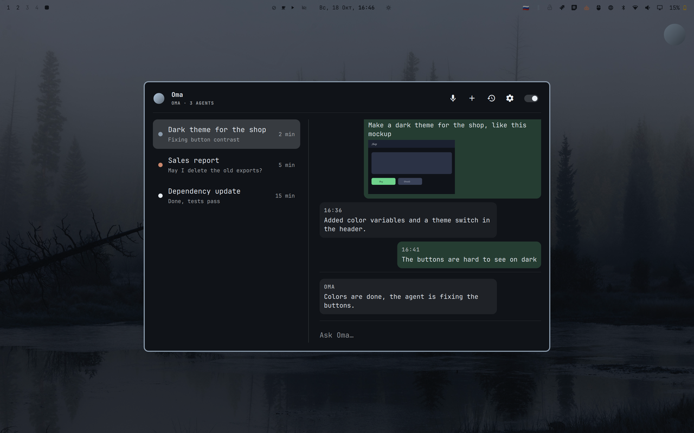

# agent-speak

Озвучка ИИ-агентов (Claude Code, Codex) и голосовой заместитель **Ома**. Ома следит за агентами, которых запустил пользователь, коротко докладывает их состояние голосом и текстом и отвечает на вопросы. Голос — Silero, по-русски. Текст готовится к чтению без ИИ на пути к звуку: код и markdown выбрасываются, пути — имя файла, числа — словами, английские термины — по словарю.

## Ома

- **Орб** — кружок поверх всех окон, и полноэкранных тоже (настройка «Над полноэкранными окнами» выключена — под ними). Клик — разговор с Омой, ПКМ — окно. Перетаскивается куда угодно; отпущенный у угла (ближе ~64 px) защёлкивается в угол, у края вне угла остаётся где отпущен; место запоминается.
- **Состояния орба** — цвет и тонкая иконка в центре, из одного в другое орб перетекает плавно: плоский градиент акцента темы — покой; зелёно-жёлтый с микрофоном, плывёт и дышит — слушаю; жёлтый с мозгом, кружится — думаю; синий с динамиком, пульсирует — говорю; как покой, с паузой — пауза (микрофон занят другой программой); красный с «?» — агент ждёт ответа; пунктирное кольцо над бледным зелёным — загрузка слуха; луна — тихий режим; бледное кольцо — Ома не запущена. Иконки — [Lucide](https://lucide.dev) (ISC).
- **Пузыри** у орба — до трёх, самый старый тает. По тону различаются: вы, Ома, агенты; кто говорит — приглушённым капсом над текстом. Пузыри агентов — пересказы Омы (итог хода, вопрос, важное промежуточное), а не сырой текст агента. Пока вы говорите, виден черновик «…», дальше — распознанный текст; кнопки «Отправить» нет. ЛКМ — окно с чатом пузыря (у агента — его чат, иначе — текущий чат Омы), ПКМ — убрать пузырь (черновик — отменить фразу, как Esc). Вне тихого режима гаснут через 10 секунд, в тихом — висят до ПКМ. Единственный агент в фокусе пузырей не даёт — на него и так смотрят; агентов несколько — пузыри есть.
- **Окно** (`Super+Shift+S`): слева агенты (работает / ждёт ответа / готово / простаивает), справа чат с Омой и поле ввода; чат держится у нижней границы. Пока окно открыто, разговор идёт в чате, пузырей нет. В шапке — счётчик ждущих агентов, микрофон (акцентный, пока идёт разговор), новый чат, история, настройки; у края — тумблер «Озвучивать агентов». Клик или Enter по агенту — его чат: лента агента и разговор с Омой о нём; Esc — назад. Реплики — пузыри: ваши справа, зелёные; Омы и агента слева. Лента агента — его последние 20 реплик из транскрипта Claude Code (ваши промпты, в том числе отправленные посреди хода, тексты агента и пересказ хода, который терминал показывает репликами); служебное — отчёты сабагентов, `<task-notification>`, тексты навыков, подписи картинок — не показывается. Посреди хода лента живая (хуки), в конце хода сверяется с транскриптом; последний ответ, который Claude Code ещё не дописал в файл, при сверке остаётся. Сообщения показываются целиком (до 8000 символов) и с разметкой Markdown: списки, заголовки, код, ссылки. Скриншоты, отправленные агенту, — миниатюрами в вашем пузыре; клик открывает картинку поверх окна Омы, клик или Esc закрывает; демон сохраняет их из транскрипта в `~/.cache/agent-speak/images`. Текст, набранный в окне, продолжает разговор.
- **Название агента:** имя из `/rename`, иначе заголовок, который Claude Code сам даёт сессии (`ai-title` в транскрипте), иначе папка.
- **Разговор** (клик по орбу, `Super+Ctrl+Alt+S`, микрофон в окне): Ома слушает; фразы копятся и уходят через ~2 секунды после конца речи; после ответа слушает снова. Клик во время «слушаю» — конец разговора, клик во время «думаю» или «говорю» — перебить. Перебить можно и голосом. Esc во время фразы отменяет её, Ома продолжает слушать. Разговор кончается сам после 30 секунд тишины, при блокировке экрана и сне. Пока идёт диктовка voxtype или созвон (микрофон захвачен другой программой), Ома не слушает.
- **Тихий режим:** ничего не звучит, только текст. По расписанию (по умолчанию 23:00–08:00) и вручную; ручное переключение действует до ближайшей границы расписания.
- **Что видит Ома:** сводку и ленты агентов, конец переписки любого агента (по умолчанию — в фокусе), выделенный мышью текст, поиск в интернете. Снимков экрана нет. Права — только чтение: Ома ничего не меняет и агентам не пишет.
- **Мозг** — сессия Claude Agent SDK на чат (`~/.local/share/agent-speak/oma`), модель Sonnet, ответы в одну-три фразы. Чат агента привязан к его сессии; общий чат после двух часов тишины начинается заново.
- **Слух** — whisper large-v3-turbo на видеокарте. От сети модель загружена всегда (клик → «слушаю» мгновенно), от батареи — по первому клику и выгружается после 5 минут тишины. Нужны наушники или эхоподавление в тракте микрофона ([omarchy-mic-denoise](https://github.com/predmaxim/omarchy-mic-denoise)).

## Как звучат агенты

- **Ома пересказывает.** Дословно агенты не звучат. Конец хода, вопрос агента и текст работающего агента за минуту уходят лёгкой модели (Haiku); она отвечает одной-двумя фразами по-русски, без имён файлов, функций и команд: что сделано, что требует внимания, что дальше. Пересказ попадает в пузырь агента и в строку «что сейчас» в окне. Промежуточное в пузырь и в речь — только важное (проблема, смена плана, неожиданный результат); неважное меняет лишь строку в окне. Модель не ответила или ответила не по форме — для итога звучит «готово», для вопроса — перевод уведомления Claude Code; промежуточное без модели молчит.
- **Что звучит.** Вопросы агентов — всегда (кроме тихого режима). Итоги и важное промежуточное — только при включённом «Озвучивать агентов» (`agents_voice`, по умолчанию выключено); иначе они только в пузырях и в окне. Каждая новость начинается с названия проекта: «agent-speak: фича готова, тесты прошли».
- **Приоритет.** Новости ждут, пока нет разговора с Омой и окна ответа (микрофон открыт — Ома услышала бы себя) и ничего другого не звучит, и уходят одной фразой: сначала вопрос, потом итоги, промежуточное — когда сказать больше нечего. Вопросы — по одному, старший первым, с «После этого ещё N вопросов». После озвученного вопроса итоги ждут ответа до 2 минут; ответ в терминале (промпт, разрешение или конец хода) снимает ожидание, а ещё не озвученный вопрос этого агента уже не звучит. Новый вопрос агента заменяет прежний; закрытый агент вопросов не держит.
- **Окно ответа.** Когда новости доиграли (вместе с хвостом звука — чтобы не слышать себя), Ома 5 секунд слушает: ответ голосом становится обычным разговором, тишина — окно закрывается. Слух загружается заранее, пока новость звучит. Окно не открывается в тихом режиме, на заблокированном экране, при занятом микрофоне и во время разговора.
- **Тишина.** В тихом режиме пересказы — только в пузырях; новости тишины не копятся и после неё не звучат.
- **Ручное чтение** (`agent-speak read`) — ход окна в фокусе целиком, дословно, звучит и в тихом режиме.
- **Уведомления Claude Code** переводятся на русский — это запасная фраза вопроса: «Клоду нужно разрешение на команду», «Клод задал вопрос». Что именно ждёт Claude, берётся из последнего вызова инструмента в транскрипте. Незнакомые тексты и инструменты остаются как есть — пора добавить перевод в `notification_text` (`src/daemon.rs`). «Клод ждёт ответа» (простой после хода) не звучит.

## Управление

| Что | Как |
|---|---|
| Окно Омы | `omarchy-shell predmaxim.oma toggle` (Super+Shift+S), ПКМ по орбу |
| Начать / закончить разговор | клик по орбу, микрофон в шапке окна, `agent-speak voice` (Super+Ctrl+Alt+S), `omarchy-shell predmaxim.oma talk` |
| Отменить фразу | `Esc` во время фразы, `omarchy-shell predmaxim.oma cancel` |
| Озвучивать агентов | тумблер в окне, `agents_voice` в настройках |
| Прочитать ход окна в фокусе / остановить | `agent-speak read` (Super+Shift+Alt+S) |
| Пауза / продолжить | `agent-speak pause` (Super+Ctrl+Shift+Alt+S) |
| Стоп | `agent-speak stop` (диктовка voxtype тоже останавливает — у автора `Alt+Space`) |

Хоткеи задаются в Hyprland (у автора — `omarchy-dotfiles`, `hyprland.lua`). Esc плагин ловит сам: временный бинд Hyprland включается только пока идёт фраза и 1 секунду после отмены, в остальное время Esc достаётся программе под окном.

Уведомления — только о том, чего не видно на орбе: «Нечего читать», «В фокусе нет агента», «Синтез упал», ошибки Омы (одинаковый текст — не чаще раза в 5 минут).

## Настройки

`~/.config/agent-speak/config.toml` (сервис перечитывает файл сам; удобнее — страница настроек в окне Омы):

| Ключ | Значения | По умолчанию |
|---|---|---|
| `agents_voice` | `true` / `false` — озвучивать пересказы итогов и важного промежуточного (вопросы агентов и ответы Омы звучат всегда) | `false` |
| `speaker` | `xenia`, `baya`, `kseniya`, `aidar`, `eugene` | `xenia` |
| `rate` | `x-slow` … `x-fast` | `medium` |
| `quiet_schedule` | `true` / `false` | `true` |
| `quiet_from`, `quiet_to` | `ЧЧ:ММ` | `23:00`, `08:00` |
| `quiet_override` | `""` / `on` / `off` (до границы расписания) | `""` |
| `orb_pos` | `угол,dx,dy` — угол `top-left`, `top-right`, `bottom-left`, `bottom-right` и отступ в пикселях (орб тащится мышью) | `bottom-right,0,0` |
| `orb_over_fullscreen` | `true` / `false` — орб и пузыри и над полноэкранными окнами (слой Overlay), иначе под ними (Top); меняется на лету | `true` |

Словарь произношений — `~/.local/share/agent-speak/terms.tsv` (`слово<TAB>произношение`, `+` — ударение). Незнакомые слова сначала читаются транслитерацией, а фоновая самая лёгкая модель агента дописывает их в словарь.

## Устройство

- `agent-speakd` — сервис на Rust (`systemctl --user status agent-speakd`; журнал `journalctl --user -u agent-speakd`). Держит реестр агентов (`~/.claude/sessions/*.json` — только сессии, запущенные пользователем, `entrypoint: cli`; процессы `codex`; хуки), решает, что звучит, и держит запущенным процесс Омы (`python -m agent_voice`, перезапуск с растущей паузой 10 с → 5 мин).
- Источники агентов: Claude — хуки `MessageDisplay`, `Stop`, `UserPromptSubmit`, `Notification` и статус файла сессии; Codex — rollout-файл и `notify`.
- `src/digest.rs` — пересказ: `claude -p --model haiku` с теми же флагами, что у словаря (без сессий, настроек и инструментов), три воркера — пересказ запускает не больше трёх процессов `claude` разом; ответ — `{"say", "important"}`, не JSON — запасная фраза и строка «пересказ не удался» в журнале. В задании — хвост текста агента и последний промпт пользователя; у вопроса — последний текст агента и ввод его вызова (вопрос с вариантами, план, команда).
- `src/news.rs` — доска новостей: приоритет, вопросы по одному с «ещё N», ожидание ответа.
- `python/agent_voice/` — Ома: слух (`ear.py`), разговор (`conversation.py`), мозг (`brain.py`), контекст (`context.py`). Команды получает строками в stdin от демона (в том числе `warm` — загрузить слух заранее и `listen` с `secs` — окно ответа после новостей), события отправляет в его сокет.
- `python/silero_tts.py` — синтез Silero, модель держится в памяти.
- Сокет `$XDG_RUNTIME_DIR/agent-speak.sock`, JSON-строки. Клиенту: строка состояния (в ней `talking`, `agents_voice`, `orb_pos`, `orb_over_fullscreen`), строка `{"agents":[…]}`, затем `bubble` (у пузыря агента — `agent`, id сессии; черновик `draft` с `hearing`, `me`), `chat`, `chat_delta`, `chats`. Сервису: `subscribe`, `set`, `say`, `read`, `stop`, `pause`, `oma` (команда Оме: `talk`, `cancel`, `ask`, `open`, `new`, `chats`), от Омы — `voice`, `voice_state` (с `talking`), `hush`, `emit`; хуки — `agent-speak hook <вид>`.
- Плагин Omarchy `predmaxim.agent-speak` (`plugin/`) — панель `keepLoaded`: орб, пузыри, окно.

## Установка и тесты

`./install.sh` — сборка, сервис `systemd --user`, venv с Silero и voice-venv для Омы, ссылка на плагин. Плагин включается `omarchy plugin enable predmaxim.agent-speak`. Хуки Claude (`~/.claude/settings.json`: `Stop`, `UserPromptSubmit`, `Notification`, `MessageDisplay` → `agent-speak hook <вид>`) и `notify` Codex (`~/.codex/config.toml`) подключаются вручную.

Тесты: `cargo test`, с моделью — `cargo test -- --ignored` и `python/test_silero_tts.py`; Ома — `~/.local/share/agent-speak/voice-venv/bin/python -m pytest python/test_agent_voice.py`; плагин — `node plugin/test.js`.

Проекты: `docs/superpowers/specs/`.
